<div align="center">

# PROJECTE INTERMODULAR

### Fase 1 · Despliegue de infraestructura de red y virtualización

**Enric Soler i Godes** · 2º ASIX
**Grupo Madrid**

</div>

---

## Índice

- [Práctica 2. Instalación de Proxmox en el servidor y estudio de IPs](#práctica-2-instalación-de-proxmox-en-el-servidor-y-estudio-de-ips)
  - [2.1 Esquema de red](#21-esquema-de-red)
  - [2.2 Instalación del hipervisor Proxmox VE](#22-instalación-del-hipervisor-proxmox-ve)
  - [2.3 Despliegue del cliente Linux](#23-despliegue-del-cliente-linux)
  - [2.4 Acceso y configuración del switch Cisco](#24-acceso-y-configuración-del-switch-cisco)
  - [2.5 Creación y nombrado de las VLAN](#25-creación-y-nombrado-de-las-vlan)
  - [2.6 Asignación de interfaces a las VLAN](#26-asignación-de-interfaces-a-las-vlan)
  - [2.7 Verificación de las VLAN](#27-verificación-de-las-vlan)
- [Práctica 3. Despliegue de equipos](#práctica-3-despliegue-de-equipos)
  - [3.1 Verificación de conectividad](#31-verificación-de-conectividad)
  - [3.2 Acceso a la interfaz web de Proxmox VE](#32-acceso-a-la-interfaz-web-de-proxmox-ve)
  - [3.3 Carga de la imagen ISO](#33-carga-de-la-imagen-iso)
  - [3.4 Planificación y esquema de particionado (Tarea 1)](#34-planificación-y-esquema-de-particionado-tarea-1)
  - [3.5 Despliegue de la máquina virtual Ubuntu Server](#35-despliegue-de-la-máquina-virtual-ubuntu-server)
  - [3.6 Verificación del almacenamiento en Ubuntu Server](#36-verificación-del-almacenamiento-en-ubuntu-server)
  - [3.7 Despliegue de la máquina virtual cliente Linux Mint](#37-despliegue-de-la-máquina-virtual-cliente-linux-mint)
  - [3.8 Verificación del almacenamiento en Linux Mint](#38-verificación-del-almacenamiento-en-linux-mint)

---

# Práctica 2. Instalación de Proxmox en el servidor y estudio de IPs

### 2.1 Esquema de red

Antes de instalar el hipervisor se define el esquema de red del entorno: los dispositivos disponibles, las VLAN configuradas en el switch y la asignación de sus puertos.

**Inventario de dispositivos**

Estos son los dispositivos de los que disponemos y sus características:

| Dispositivo | Tipo | IP | VLAN | Puerto | Estado |
|:--|:--|:--|:-:|:--|:--|
| **Proxmox** | Servidor físico | 10.2.10.1/24 | 210 | 11 | Conectado |
| **Linux Mint** | Cliente físico | 10.2.10.2/24 | 210 | 12 | Conectado |
| **Ubuntu Server** | Servidor físico | 10.2.10.3/24 | 210 | Sin asignar | No conectado aún |
| **Switch Cisco** | Gestión | 10.2.99.1/24 | 299 | Puerto de gestión | Activo |

**Segmentación en VLAN**

Estas son las VLAN que hemos asignado. Cada una dispone de su propio direccionamiento IP /24 y de una pareja de interfaces del switch:

| VLAN | Nombre | Red | Interfaces del switch |
|:-:|:--|:--|:-:|
| **210** | servidor_mad | 10.2.10.0/24 | 11, 12 |
| **220** | comercial_mad | 10.2.20.0/24 | 13, 17 |
| **230** | produccion_mad | 10.2.30.0/24 | 14, 18 |
| **299** | gestion_mad | 10.2.99.0/24 | 16, 19 |

**Asignación de puertos del switch Cisco**

Esta es la distribución final de los puertos 11 a 20 del switch Cisco, con la VLAN a la que pertenece cada uno y el dispositivo conectado en la actualidad:

| Puerto | VLAN | Nombre VLAN | Dispositivo conectado |
|:-:|:-:|:--|:--|
| 11 | 210 | servidor_mad | Servidor Proxmox |
| 12 | 210 | servidor_mad | Cliente Linux Mint |
| 13 | 220 | comercial_mad | *Libre* |
| 14 | 230 | produccion_mad | *Libre* |
| 15 | Sin asignar | - | *Libre* |
| 16 | 299 | gestion_mad | *Libre* |
| 17 | 220 | comercial_mad | *Libre* |
| 18 | 230 | produccion_mad | *Libre* |
| 19 | 299 | gestion_mad | *Libre* |
| 20 | Sin asignar | - | *Libre* |

### 2.2 Instalación del hipervisor Proxmox VE

Se descarga la imagen ISO oficial de Proxmox VE, que será el hipervisor instalado directamente sobre el hardware (*bare metal*) del servidor físico.

<p align="center"><br><sub><em>Figura 1. Descarga de la ISO de Proxmox</em></sub></p>

Para generar el medio de instalación se utiliza **balenaEtcher**, herramienta que escribe la imagen ISO en un dispositivo USB y lo deja configurado como unidad de arranque.

<p align="center"><br><sub><em>Figura 2. Descarga de balenaEtcher</em></sub></p>

Se selecciona la ISO de origen y la unidad USB de destino, y se lanza el proceso de escritura (*flasheo*) del medio.

<p align="center"><br><sub><em>Figura 3. Preparación para flashear la ISO</em></sub></p>

A continuación se arranca el servidor físico desde el USB y se ejecuta el asistente de instalación de Proxmox VE.

<p align="center"><br><sub><em>Figura 4. Servidor encendido</em></sub></p>

<p align="center"><br><sub><em>Figura 5. Instalación de Proxmox</em></sub></p>

Durante la instalación se configura la red de gestión del servidor (dirección IP, máscara de subred, puerta de enlace y DNS). Una vez finalizada, se comprueba que los parámetros se han aplicado correctamente.

<p align="center"><br><sub><em>Figura 6. Configuración de las IPs del servidor</em></sub></p>

### 2.3 Despliegue del cliente Linux

Se despliega el cliente Linux Mint en la estación de trabajo.

> ⚠️ **Nota:** la captura pertenece a pruebas previas con Ubuntu Client, descartado por incompatibilidades técnicas. No se documentó gráficamente la instalación final de Linux Mint.

<p align="center"><br><sub><em>Figura 7. Instalación de Ubuntu (pruebas previas)</em></sub></p>

### 2.4 Acceso y configuración del switch Cisco

Se instala y configura **PuTTY** como cliente de terminal para acceder al switch Cisco y habilitar el acceso remoto por **Telnet**.

<p align="center"><br><sub><em>Figura 8. Instalación de PuTTY</em></sub></p>

<p align="center"><br><sub><em>Figura 9. Configuración de PuTTY</em></sub></p>

Se realiza la configuración inicial del switch (acceso de gestión y parámetros básicos).

<p align="center"><br><sub><em>Figura 10. Switch (detalle)</em></sub></p>

<p align="center"><br><sub><em>Figura 11. Configuración del switch</em></sub></p>

Se verifica que la configuración se ha guardado correctamente y que es posible conectarse al switch por Telnet directamente, sin necesidad de PuTTY.

<p align="center"><br><sub><em>Figura 12. Comprobación de la conexión por Telnet</em></sub></p>

### 2.5 Creación y nombrado de las VLAN

Se crean las VLAN en el switch y se les asigna el nombre correspondiente según su función.

```
Switch(config)# vlan <id>
Switch(config-vlan)# name <nombre>
```

<p align="center"><br><sub><em>Figura 13. Nombres de las VLAN</em></sub></p>

### 2.6 Asignación de interfaces a las VLAN

Se accede a la interfaz `GigabitEthernet 0/12` del switch Cisco. Una vez dentro, se configura la interfaz en **modo acceso** (`switchport mode access`) y se le asigna la **VLAN 210** (`switchport access vlan 210`), de modo que el puerto pase a transportar únicamente tráfico sin etiquetar de dicha VLAN.

```
Switch(config)# interface GigabitEthernet 0/12
Switch(config-if)# switchport mode access
Switch(config-if)# switchport access vlan 210
```

<p align="center"><br><sub><em>Figura 14. Configuración de la interfaz Gi0/12</em></sub></p>

El mismo procedimiento se repite para el resto de interfaces y VLAN.

<p align="center"><br><sub><em>Figura 15. Configuración del resto de VLAN</em></sub></p>

### 2.7 Verificación de las VLAN

Se ejecuta el comando `show vlan brief` para validar la creación de las VLAN y la asignación de puertos. En la comprobación se detectan algunos errores de configuración (nombres o puertos asignados incorrectamente).

<p align="center"><br><sub><em>Figura 16. Resultado de show vlan brief</em></sub></p>

---

# Práctica 3. Despliegue de equipos

Se corrigen los errores detectados y se vuelve a ejecutar `show vlan brief` para confirmar que el estado de las VLAN y la asignación de puertos son los esperados.

<p align="center"><br><sub><em>Figura 17. show vlan brief tras corregir</em></sub></p>

### 3.1 Verificación de conectividad

Verificamos que la configuración de red está correctamente configurada y realizamos un `ping` al servidor para comprobar la conectividad entre cliente y servidor dentro de la VLAN 210.

<p align="center"><br><sub><em>Figura 18. Configuración de la red</em></sub></p>

<p align="center"><br><sub><em>Figura 19. Ping entre cliente y servidor</em></sub></p>

### 3.2 Acceso a la interfaz web de Proxmox VE

Una vez finalizada la configuración de red del servidor, se accede a la consola de administración de Proxmox VE mediante un navegador web, a través del puerto HTTPS **8006** de la IP de gestión del host (`https://10.2.10.1:8006`). La pantalla de inicio de sesión solicita usuario y contraseña, y permite seleccionar el *realm* de autenticación (en este caso **Linux PAM standard authentication**, que valida contra los usuarios del sistema operativo del host) y el idioma de la interfaz.

<p align="center">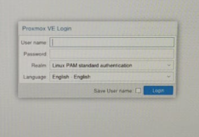<br><sub><em>Figura 20. Pantalla de inicio de sesión de Proxmox VE</em></sub></p>

### 3.3 Carga de la imagen ISO

Para poder crear la máquina virtual es necesario disponer del medio de instalación en el almacenamiento del nodo. Se sube la imagen ISO de Ubuntu Server al almacenamiento `local` de Proxmox, de forma que quede disponible como unidad de CD/DVD virtual en el asistente de creación de máquinas. El archivo ocupa **2,73 GiB** y se identifica con el tipo MIME `application/vnd.efi.iso`. Proxmox avisa de que las subidas se almacenan temporalmente en `/var/tmp`, por lo que debe haber espacio libre suficiente en esa ruta antes de iniciar la carga.

<p align="center">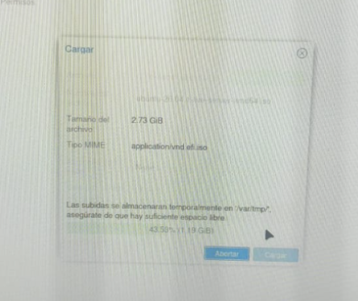<br><sub><em>Figura 21. Carga de la imagen ISO en el almacenamiento de Proxmox</em></sub></p>

### 3.4 Planificación y esquema de particionado (Tarea 1)

Antes de iniciar el instalador se elabora la **tabla de diseño técnico** del almacenamiento, indicando para cada punto de montaje el disco, el tamaño, el sistema de ficheros y su función. El servidor debe cumplir el siguiente esquema obligatorio:

| Disco | Punto de montaje | Sistema de ficheros | Tamaño | Uso |
|:--|:--|:--|:-:|:--|
| `scsi0` | `/boot/efi` | vfat (FAT32) | 538 MB | Partición de sistema EFI |
| `scsi0` | `/boot` | ext4 | 483 MB | Núcleo Linux e *initramfs* |
| `scsi1` | `/` | ext4 | 20 GB | Sistema operativo |
| `scsi2` | `/home` | ext4 | 30 GB | Directorios de los usuarios |
| `scsi3` | swap | swap | 10 GB | Memoria de intercambio (extra) |

El criterio técnico del diseño es el siguiente:

- **`/boot/efi` en vfat:** el firmware UEFI solo sabe leer la partición de sistema EFI (ESP) si está formateada en FAT32, y debe estar al inicio del disco de arranque.
- **`/boot` separado en ext4:** aísla el núcleo y el *initramfs* del resto del sistema, lo que simplifica el arranque y la recuperación.
- **`/` y `/home` en discos distintos:** los datos de los usuarios sobreviven a una reinstalación o restauración del sistema, y cada volumen puede ampliarse de forma independiente.

> **Observación:** el disco `scsi0` se creó con 1 GiB, por lo que `/boot` queda en 483 MB, por debajo del 1 GB que indica el enunciado. Para ajustarse por completo, este disco debería tener un mínimo de 2 GiB (512 MB de ESP más 1 GB de `/boot`).

El mismo esquema se aplica al equipo cliente, con tres discos virtuales:

| Disco | Punto de montaje | Sistema de ficheros | Tamaño | Uso |
|:--|:--|:--|:-:|:--|
| `scsi0` | `/boot/efi` | vfat (FAT32) | 487 MiB | Partición de sistema EFI |
| `scsi0` | `/boot` | ext4 | 977 MiB | Núcleo Linux e *initramfs* |
| `scsi1` | `/` | ext4 | 30 GB | Sistema operativo |
| `scsi2` | `/home` | ext4 | 30 GB | Directorios de los usuarios |

En el cliente, el área de intercambio no se define como partición: la gestiona el instalador mediante el archivo `/swapfile`.

### 3.5 Despliegue de la máquina virtual Ubuntu Server

Se crea la máquina virtual **ubuntuSRV** en el nodo `madrid` con el asistente de Proxmox. Antes de terminar, la pantalla de confirmación permite revisar sus características principales:

| Parámetro | Valor |
|:--|:--|
| Arranque | UEFI (`ovmf`) |
| Procesador | 2 núcleos |
| Memoria | 4096 MiB |
| Red | Interfaz VirtIO conectada al puente `vmbr0` |
| Discos | Discos SCSI sobre `local-lvm` |
| Imagen de instalación | `ubuntu-26.04.1-live-server-amd64.iso` |

<p align="center">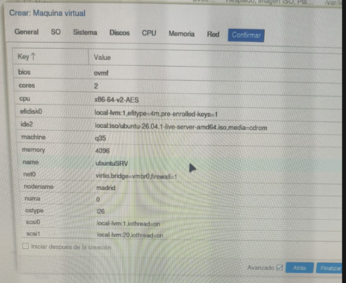<br><sub><em>Figura 22. Características de la máquina virtual Ubuntu Server</em></sub></p>

Siguiendo el esquema planificado en el apartado 3.4, durante la instalación se configura el almacenamiento de forma manual, asignando cada punto de montaje a su disco.

<p align="center">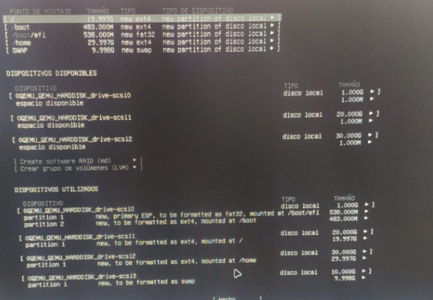<br><sub><em>Figura 23. Esquema de particiones del servidor Ubuntu Server</em></sub></p>

Después se indica el nombre del servidor (`srv-ubuntu`), el usuario (`ubuntu`) y su contraseña.

<p align="center">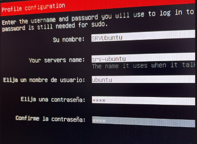<br><sub><em>Figura 24. Nombre del servidor, usuario y contraseña</em></sub></p>

### 3.6 Verificación del almacenamiento en Ubuntu Server

Con el sistema ya instalado, se comprueba desde la terminal que todo está como se planificó. Primero se entra en el directorio `/sys` y se muestra su contenido; después se ejecuta `df -h`, que lista las particiones montadas con su tamaño y su punto de montaje.

```
$ cd /sys
$ ls
$ df -h
```

La salida confirma que `/` está en `/dev/sdb1` (20 GB), `/home` en `/dev/sdc1` (30 GB), `/boot` en `/dev/sda2` y `/boot/efi` en `/dev/sda1`.

<p align="center">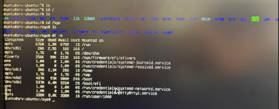<br><sub><em>Figura 25. Contenido de /sys y resultado de df -h</em></sub></p>

Por último, se abre el archivo `/etc/fstab`, donde el sistema guarda qué particiones debe montar al arrancar. Aparecen las mismas particiones que en la tabla de diseño, identificadas por su UUID.

```
$ sudo nano /etc/fstab
```

<p align="center">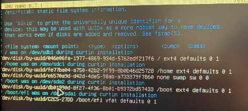<br><sub><em>Figura 26. Contenido del archivo /etc/fstab en Ubuntu Server</em></sub></p>

### 3.7 Despliegue de la máquina virtual cliente Linux Mint

El cliente se crea también como máquina virtual en Proxmox, a partir de la imagen `linuxmint-22.3-cinnamon-64bit.iso`. En la pestaña **SO** se elige la imagen y se indica que el sistema es de tipo Linux.

<p align="center">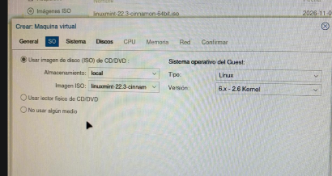<br><sub><em>Figura 27. Asistente de creación de la VM: pestaña SO</em></sub></p>

En la pestaña **Sistema** se selecciona el arranque UEFI (OVMF) y el controlador VirtIO SCSI single.

<p align="center">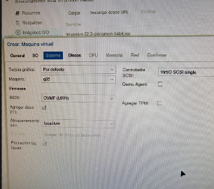<br><sub><em>Figura 28. Asistente de creación de la VM: pestaña Sistema</em></sub></p>

En la pestaña **Discos** se crea el primer disco, de 15 GiB. La máquina tiene además dos discos de 30 GiB.

<p align="center">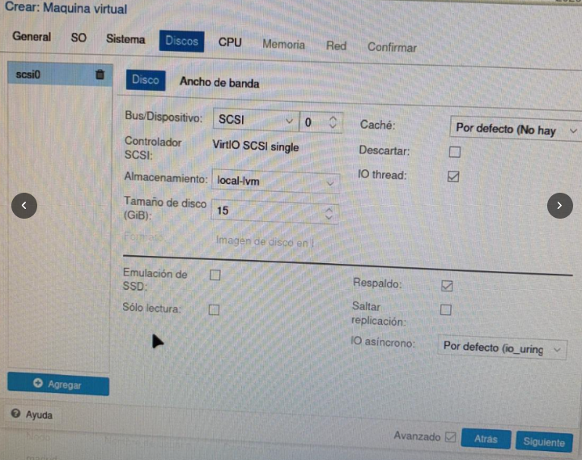<br><sub><em>Figura 29. Asistente de creación de la VM: pestaña Discos</em></sub></p>

Durante la instalación se prepara el particionado del cliente. En la captura se asigna la partición `/dev/sdc1` a `/home` y se marca para formatearla.

<p align="center">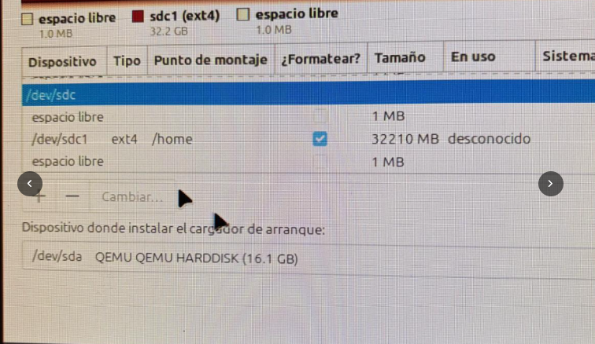<br><sub><em>Figura 30. Particionado del disco del cliente Linux Mint</em></sub></p>

Por último, se crea el usuario del equipo (`mintmadrid`) y su contraseña.

<p align="center">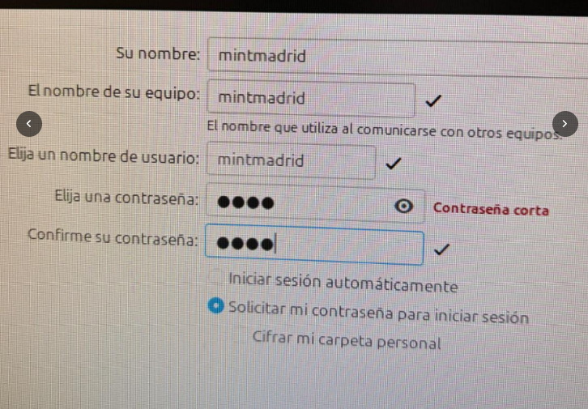<br><sub><em>Figura 31. Creación del usuario y la contraseña del cliente</em></sub></p>

### 3.8 Verificación del almacenamiento en Linux Mint

Ya instalado el cliente, se repiten las comprobaciones en la terminal: se lista el contenido de `/sys/firmware/efi` y se ejecuta `lsblk`, que muestra los discos y sus particiones.

```
$ ls -l /sys/firmware/efi
$ lsblk -o NAME,FSTYPE,SIZE,MOUNTPOINTS
```

El resultado muestra los tres discos: `sda` (15 GB) con `/boot/efi` y `/boot`, `sdb` (30 GB) con `/` y `sdc` (30 GB) con `/home`.

<p align="center">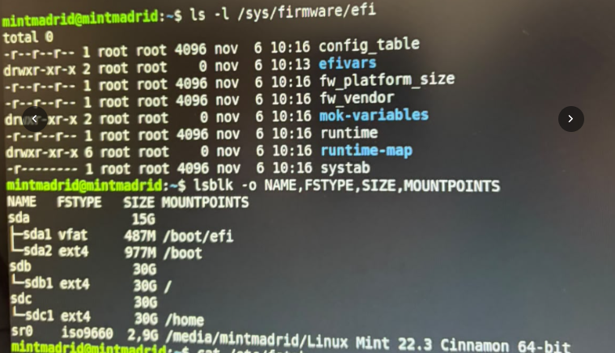<br><sub><em>Figura 32. Contenido de /sys/firmware/efi y resultado de lsblk</em></sub></p>

Finalmente, se consulta `/etc/fstab` del cliente, que lista las particiones que se montan al arrancar.

```
$ cat /etc/fstab
```

<p align="center">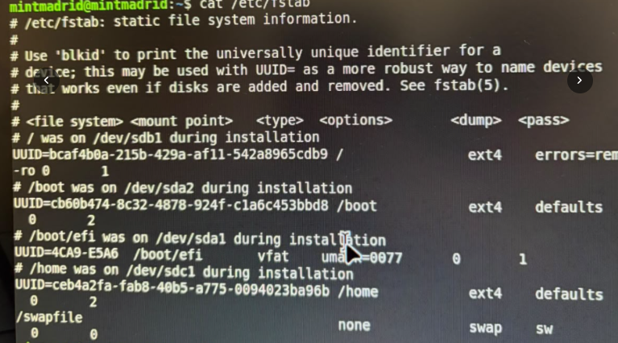<br><sub><em>Figura 33. Contenido del archivo /etc/fstab en Linux Mint</em></sub></p>

---

<div align="center">

**Projecte Intermodular** · Enric Soler i Godes · 2º ASIX · Grupo Madrid

</div>
