<div align="center">

# PROJECTE INTERMODULAR

### Fase 1 · Despliegue de infraestructura de red y virtualización

**Enric Soler i Godes** · 2º ASIX
**Grupo Madrid**

</div>

---

## Índice

- [Práctica 2. Instalación de Proxmox en el servidor y estudio de IPs](#práctica-2-instalación-de-proxmox-en-el-servidor-y-estudio-de-ips)
  - [2.1 Esquema de red](#21-esquema-de-red)
  - [2.2 Instalación del hipervisor Proxmox VE](#22-instalación-del-hipervisor-proxmox-ve)
  - [2.3 Despliegue del cliente Linux](#23-despliegue-del-cliente-linux)
  - [2.4 Acceso y configuración del switch Cisco](#24-acceso-y-configuración-del-switch-cisco)
  - [2.5 Creación y nombrado de las VLAN](#25-creación-y-nombrado-de-las-vlan)
  - [2.6 Asignación de interfaces a las VLAN](#26-asignación-de-interfaces-a-las-vlan)
  - [2.7 Verificación de las VLAN](#27-verificación-de-las-vlan)
- [Práctica 3. Despliegue de equipos](#práctica-3-despliegue-de-equipos)
  - [3.1 Verificación de conectividad](#31-verificación-de-conectividad)
  - [3.2 Acceso a la interfaz web de Proxmox VE](#32-acceso-a-la-interfaz-web-de-proxmox-ve)
  - [3.3 Carga de la imagen ISO](#33-carga-de-la-imagen-iso)
  - [3.4 Planificación y esquema de particionado (Tarea 1)](#34-planificación-y-esquema-de-particionado-tarea-1)
  - [3.5 Despliegue de la máquina virtual Ubuntu Server](#35-despliegue-de-la-máquina-virtual-ubuntu-server)
  - [3.6 Verificación del almacenamiento en Ubuntu Server](#36-verificación-del-almacenamiento-en-ubuntu-server)
  - [3.7 Despliegue de la máquina virtual cliente Linux Mint](#37-despliegue-de-la-máquina-virtual-cliente-linux-mint)
  - [3.8 Verificación del almacenamiento en Linux Mint](#38-verificación-del-almacenamiento-en-linux-mint)
- [Práctica 4. Despliegue de servicios con Windows Server](#práctica-4-despliegue-de-servicios-con-windows-server)
  - [4.1 Planificación de la infraestructura (Tarea 1)](#41-planificación-de-la-infraestructura-tarea-1)
  - [4.2 Instalación de Windows Server 2025 (Tarea 2)](#42-instalación-de-windows-server-2025-tarea-2)
  - [4.3 Configuración del almacenamiento (Tarea 3)](#43-configuración-del-almacenamiento-tarea-3)
  - [4.4 Configuración TCP/IP del servidor (Tarea 4)](#44-configuración-tcpip-del-servidor-tarea-4)
  - [4.5 Instalación y configuración del servicio DHCP (Tarea 5)](#45-instalación-y-configuración-del-servicio-dhcp-tarea-5)

---

# Práctica 2. Instalación de Proxmox en el servidor y estudio de IPs

### 2.1 Esquema de red

Antes de instalar el hipervisor se define el esquema de red del entorno: los dispositivos disponibles, las VLAN configuradas en el switch y la asignación de sus puertos.

**Inventario de dispositivos**

Estos son los dispositivos de los que disponemos y sus características:

| Dispositivo | Tipo | IP | VLAN | Puerto | Estado |
|:--|:--|:--|:-:|:--|:--|
| **Proxmox** | Servidor físico | 10.2.10.1/24 | 210 | 11 | Conectado |
| **Linux Mint** | Cliente físico | 10.2.10.2/24 | 210 | 12 | Conectado |
| **Ubuntu Server** | Servidor físico | 10.2.10.3/24 | 210 | Sin asignar | No conectado aún |
| **Switch Cisco** | Gestión | 10.2.99.1/24 | 299 | Puerto de gestión | Activo |

**Segmentación en VLAN**

Estas son las VLAN que hemos asignado. Cada una dispone de su propio direccionamiento IP /24 y de una pareja de interfaces del switch:

| VLAN | Nombre | Red | Interfaces del switch |
|:-:|:--|:--|:-:|
| **210** | servidor_mad | 10.2.10.0/24 | 11, 12 |
| **220** | comercial_mad | 10.2.20.0/24 | 13, 17 |
| **230** | produccion_mad | 10.2.30.0/24 | 14, 18 |
| **299** | gestion_mad | 10.2.99.0/24 | 16, 19 |

**Asignación de puertos del switch Cisco**

Esta es la distribución final de los puertos 11 a 20 del switch Cisco, con la VLAN a la que pertenece cada uno y el dispositivo conectado en la actualidad:

| Puerto | VLAN | Nombre VLAN | Dispositivo conectado |
|:-:|:-:|:--|:--|
| 11 | 210 | servidor_mad | Servidor Proxmox |
| 12 | 210 | servidor_mad | Cliente Linux Mint |
| 13 | 220 | comercial_mad | *Libre* |
| 14 | 230 | produccion_mad | *Libre* |
| 15 | Sin asignar | - | *Libre* |
| 16 | 299 | gestion_mad | *Libre* |
| 17 | 220 | comercial_mad | *Libre* |
| 18 | 230 | produccion_mad | *Libre* |
| 19 | 299 | gestion_mad | *Libre* |
| 20 | Sin asignar | - | *Libre* |

### 2.2 Instalación del hipervisor Proxmox VE

Se descarga la imagen ISO oficial de Proxmox VE, que será el hipervisor instalado directamente sobre el hardware (*bare metal*) del servidor físico.

<p align="center">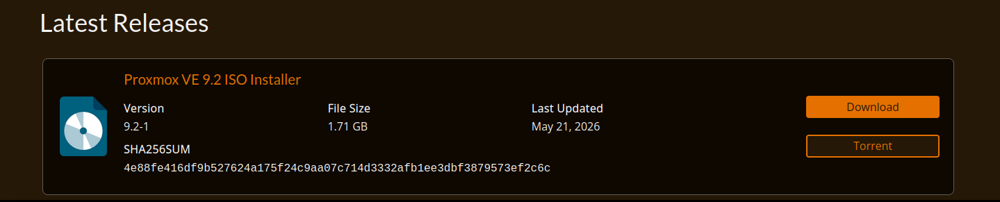<br><sub><em>Figura 1. Descarga de la ISO de Proxmox</em></sub></p>

Para generar el medio de instalación se utiliza **balenaEtcher**, herramienta que escribe la imagen ISO en un dispositivo USB y lo deja configurado como unidad de arranque.

<p align="center"><br><sub><em>Figura 2. Descarga de balenaEtcher</em></sub></p>

Se selecciona la ISO de origen y la unidad USB de destino, y se lanza el proceso de escritura (*flasheo*) del medio.

<p align="center">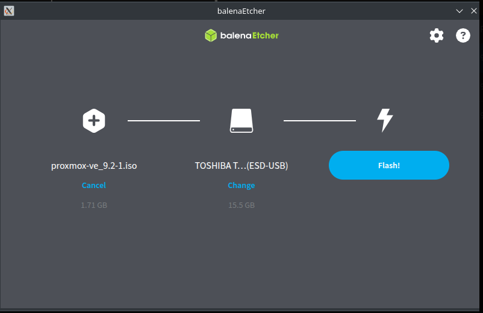<br><sub><em>Figura 3. Preparación para flashear la ISO</em></sub></p>

A continuación se arranca el servidor físico desde el USB y se ejecuta el asistente de instalación de Proxmox VE.

<p align="center">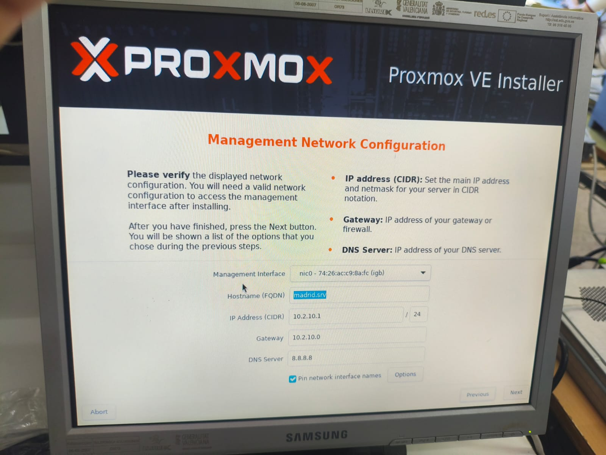<br><sub><em>Figura 4. Servidor encendido</em></sub></p>

<p align="center">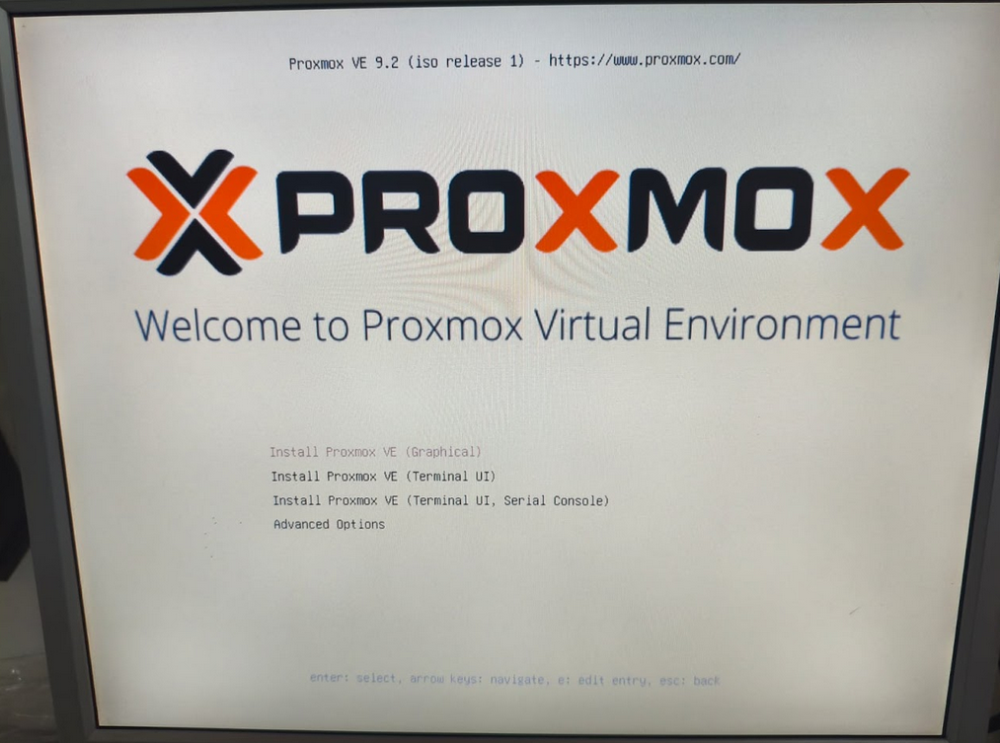<br><sub><em>Figura 5. Instalación de Proxmox</em></sub></p>

Durante la instalación se configura la red de gestión del servidor (dirección IP, máscara de subred, puerta de enlace y DNS). Una vez finalizada, se comprueba que los parámetros se han aplicado correctamente.

<p align="center">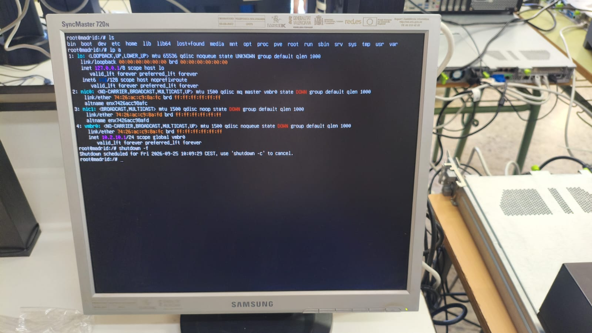<br><sub><em>Figura 6. Configuración de las IPs del servidor</em></sub></p>

### 2.3 Despliegue del cliente Linux

Se despliega el cliente Linux Mint en la estación de trabajo.

> ⚠️ **Nota:** la captura pertenece a pruebas previas con Ubuntu Client, descartado por incompatibilidades técnicas. No se documentó gráficamente la instalación final de Linux Mint.

<p align="center">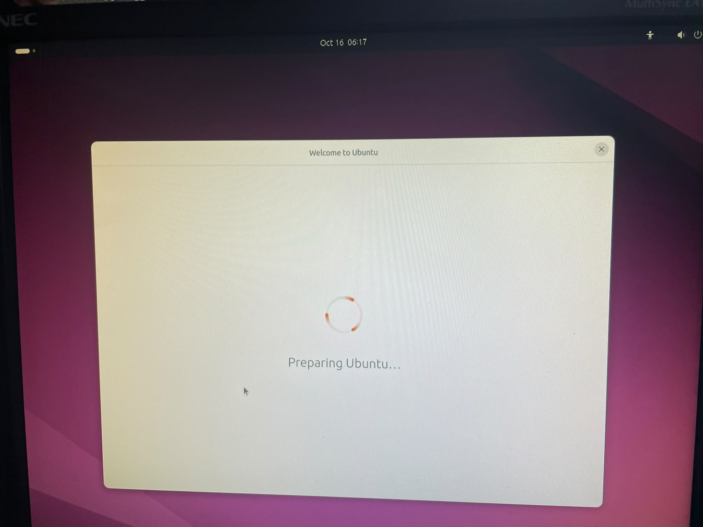<br><sub><em>Figura 7. Instalación de Ubuntu (pruebas previas)</em></sub></p>

### 2.4 Acceso y configuración del switch Cisco

Se instala y configura **PuTTY** como cliente de terminal para acceder al switch Cisco y habilitar el acceso remoto por **Telnet**.

<p align="center">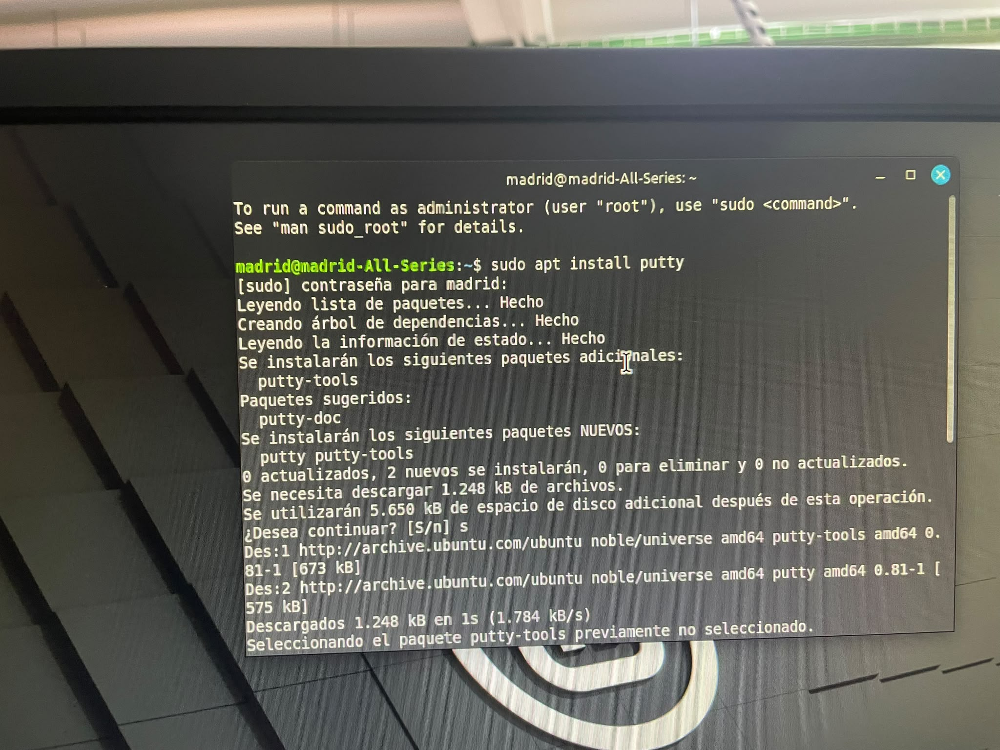<br><sub><em>Figura 8. Instalación de PuTTY</em></sub></p>

<p align="center">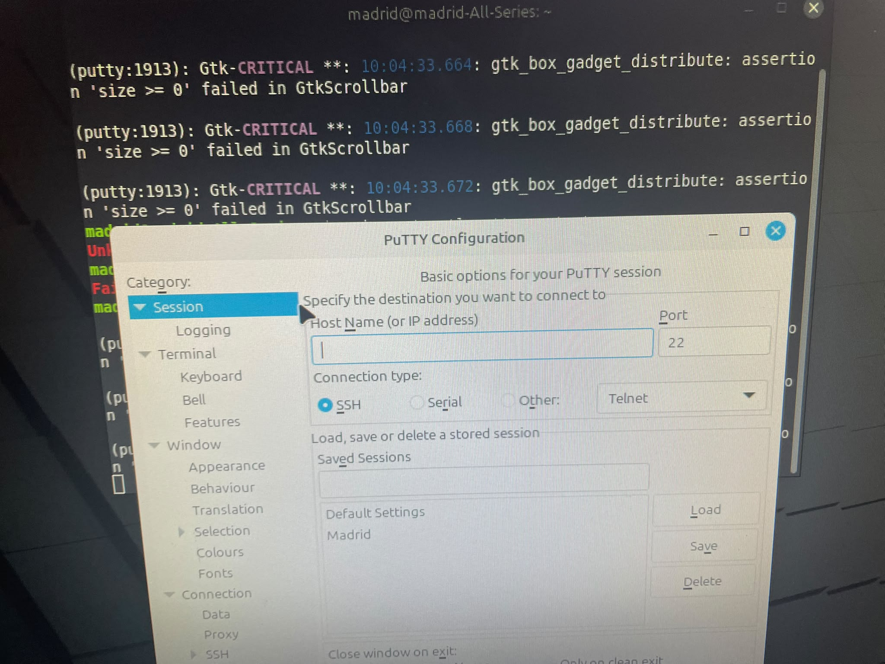<br><sub><em>Figura 9. Configuración de PuTTY</em></sub></p>

Se realiza la configuración inicial del switch (acceso de gestión y parámetros básicos).

<p align="center">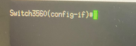<br><sub><em>Figura 10. Switch (detalle)</em></sub></p>

<p align="center">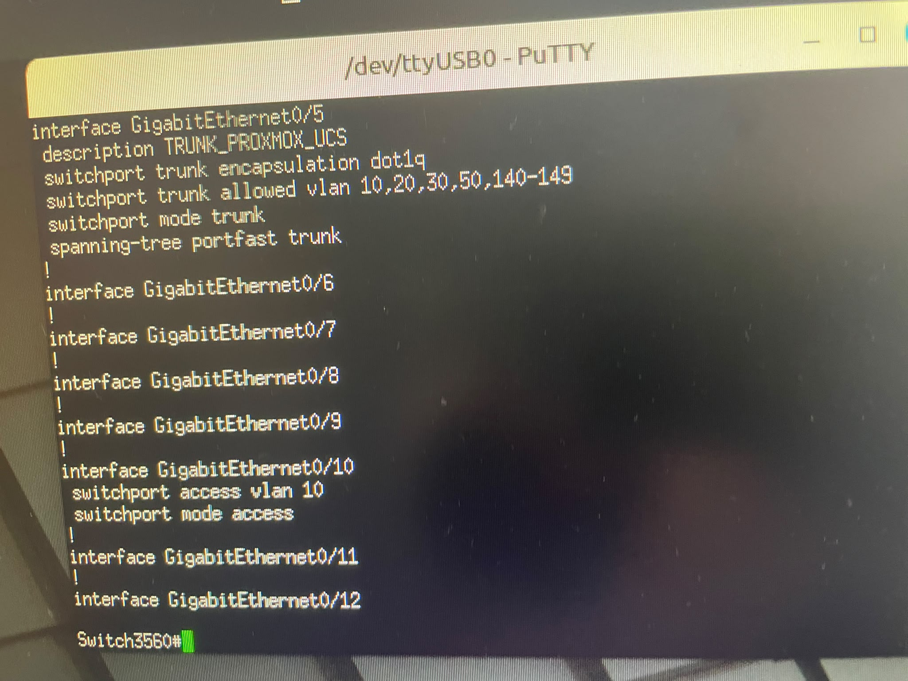<br><sub><em>Figura 11. Configuración del switch</em></sub></p>

Se verifica que la configuración se ha guardado correctamente y que es posible conectarse al switch por Telnet directamente, sin necesidad de PuTTY.

<p align="center">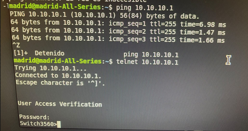<br><sub><em>Figura 12. Comprobación de la conexión por Telnet</em></sub></p>

### 2.5 Creación y nombrado de las VLAN

Se crean las VLAN en el switch y se les asigna el nombre correspondiente según su función.

```
Switch(config)# vlan <id>
Switch(config-vlan)# name <nombre>
```

<p align="center">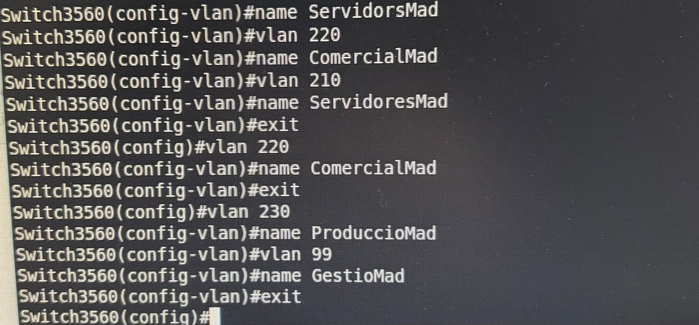<br><sub><em>Figura 13. Nombres de las VLAN</em></sub></p>

### 2.6 Asignación de interfaces a las VLAN

Se accede a la interfaz `GigabitEthernet 0/12` del switch Cisco. Una vez dentro, se configura la interfaz en **modo acceso** (`switchport mode access`) y se le asigna la **VLAN 210** (`switchport access vlan 210`), de modo que el puerto pase a transportar únicamente tráfico sin etiquetar de dicha VLAN.

```
Switch(config)# interface GigabitEthernet 0/12
Switch(config-if)# switchport mode access
Switch(config-if)# switchport access vlan 210
```

<p align="center">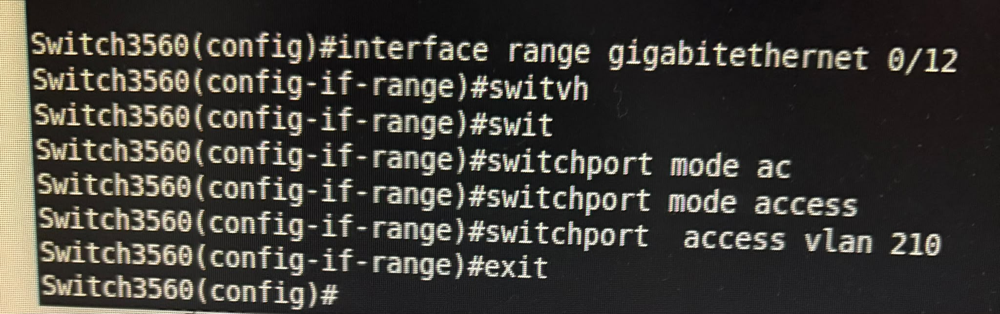<br><sub><em>Figura 14. Configuración de la interfaz Gi0/12</em></sub></p>

El mismo procedimiento se repite para el resto de interfaces y VLAN.

<p align="center">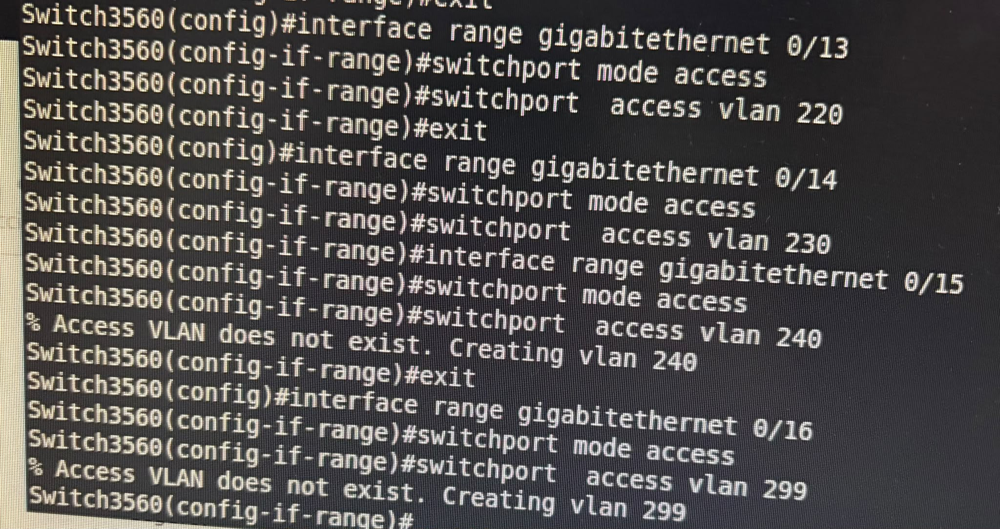<br><sub><em>Figura 15. Configuración del resto de VLAN</em></sub></p>

### 2.7 Verificación de las VLAN

Se ejecuta el comando `show vlan brief` para validar la creación de las VLAN y la asignación de puertos. En la comprobación se detectan algunos errores de configuración (nombres o puertos asignados incorrectamente).

<p align="center">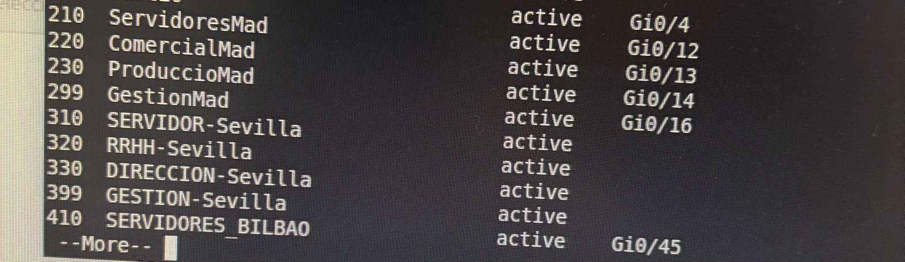<br><sub><em>Figura 16. Resultado de show vlan brief</em></sub></p>

---

# Práctica 3. Despliegue de equipos

Se corrigen los errores detectados y se vuelve a ejecutar `show vlan brief` para confirmar que el estado de las VLAN y la asignación de puertos son los esperados.

<p align="center">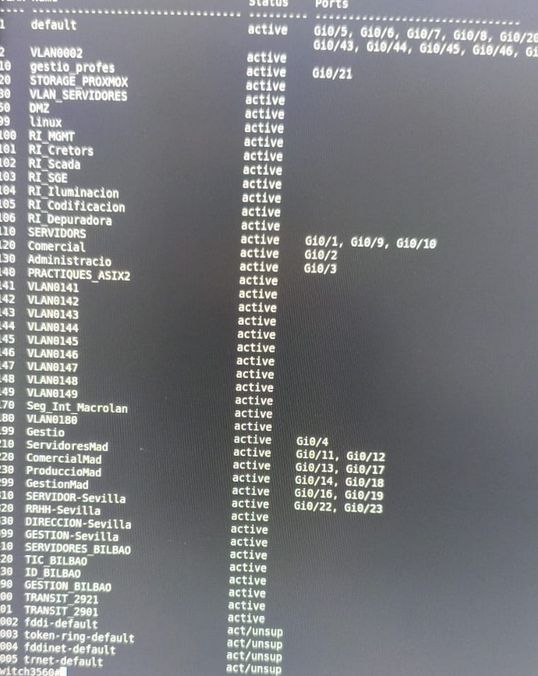<br><sub><em>Figura 17. show vlan brief tras corregir</em></sub></p>

### 3.1 Verificación de conectividad

Verificamos que la configuración de red está correctamente configurada y realizamos un `ping` al servidor para comprobar la conectividad entre cliente y servidor dentro de la VLAN 210.

<p align="center">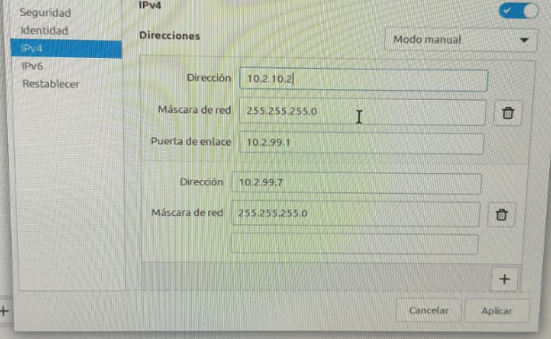<br><sub><em>Figura 18. Configuración de la red</em></sub></p>

<p align="center">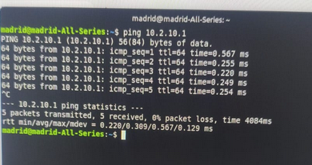<br><sub><em>Figura 19. Ping entre cliente y servidor</em></sub></p>

### 3.2 Acceso a la interfaz web de Proxmox VE

Una vez finalizada la configuración de red del servidor, se accede a la consola de administración de Proxmox VE mediante un navegador web, a través del puerto HTTPS **8006** de la IP de gestión del host (`https://10.2.10.1:8006`). La pantalla de inicio de sesión solicita usuario y contraseña, y permite seleccionar el *realm* de autenticación (en este caso **Linux PAM standard authentication**, que valida contra los usuarios del sistema operativo del host) y el idioma de la interfaz.

<p align="center">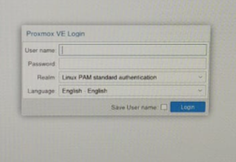<br><sub><em>Figura 20. Pantalla de inicio de sesión de Proxmox VE</em></sub></p>

### 3.3 Carga de la imagen ISO

Para poder crear la máquina virtual es necesario disponer del medio de instalación en el almacenamiento del nodo. Se sube la imagen ISO de Ubuntu Server al almacenamiento `local` de Proxmox, de forma que quede disponible como unidad de CD/DVD virtual en el asistente de creación de máquinas. El archivo ocupa **2,73 GiB** y se identifica con el tipo MIME `application/vnd.efi.iso`. Proxmox avisa de que las subidas se almacenan temporalmente en `/var/tmp`, por lo que debe haber espacio libre suficiente en esa ruta antes de iniciar la carga.

<p align="center">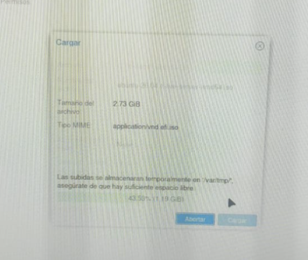<br><sub><em>Figura 21. Carga de la imagen ISO en el almacenamiento de Proxmox</em></sub></p>

### 3.4 Planificación y esquema de particionado

Antes de iniciar el instalador se diseña cómo se va a repartir el almacenamiento del servidor. Para cada disco se indica el punto de montaje, el sistema de ficheros y el tamaño:

| Disco | Punto de montaje | Sistema de ficheros | Tamaño | Uso |
|:--|:--|:--|:-:|:--|
| `scsi0` | `/boot/efi` | vfat (FAT32) | 538 MB | Partición de arranque EFI |
| `scsi0` | `/boot` | ext4 | 483 MB | Archivos de arranque del sistema |
| `scsi1` | `/` | ext4 | 20 GB | Sistema operativo |
| `scsi2` | `/home` | ext4 | 30 GB | Carpetas de los usuarios |
| `scsi3` | swap | swap | 10 GB | Memoria de intercambio (extra) |

Se separan `/` y `/home` en discos distintos para que los datos de los usuarios no se vean afectados si hay que reinstalar el sistema.

### 3.5 Despliegue de la máquina virtual Ubuntu Server

Se crea la máquina virtual **ubuntuSRV** en el nodo `madrid` con el asistente de Proxmox. Antes de terminar, la pantalla de confirmación permite revisar sus características principales:

| Parámetro | Valor |
|:--|:--|
| Arranque | UEFI (`ovmf`) |
| Procesador | 2 núcleos |
| Memoria | 4096 MiB |
| Red | Interfaz VirtIO conectada al puente `vmbr0` |
| Discos | Discos SCSI sobre `local-lvm` |
| Imagen de instalación | `ubuntu-26.04.1-live-server-amd64.iso` |

<p align="center">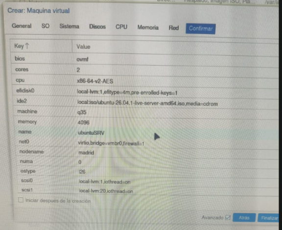<br><sub><em>Figura 22. Características de la máquina virtual Ubuntu Server</em></sub></p>

Siguiendo el esquema planificado en el apartado 3.4, durante la instalación se configura el almacenamiento de forma manual, asignando cada punto de montaje a su disco.

<p align="center">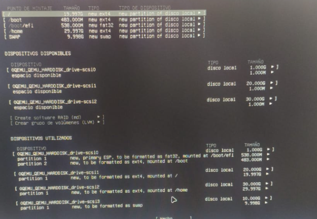<br><sub><em>Figura 23. Esquema de particiones del servidor Ubuntu Server</em></sub></p>

Después se indica el nombre del servidor (`srv-ubuntu`), el usuario (`ubuntu`) y su contraseña.

<p align="center">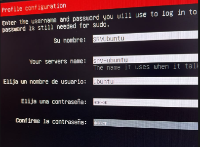<br><sub><em>Figura 24. Nombre del servidor, usuario y contraseña</em></sub></p>

### 3.6 Verificación del almacenamiento en Ubuntu Server

Con el sistema ya instalado, se comprueba desde la terminal que todo está como se planificó. Primero se entra en el directorio `/sys` y se muestra su contenido; después se ejecuta `df -h`, que lista las particiones montadas con su tamaño y su punto de montaje.

```
$ cd /sys
$ ls
$ df -h
```

La salida confirma que `/` está en `/dev/sdb1` (20 GB), `/home` en `/dev/sdc1` (30 GB), `/boot` en `/dev/sda2` y `/boot/efi` en `/dev/sda1`.

<p align="center">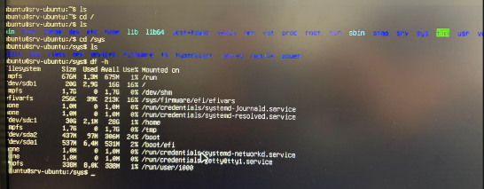<br><sub><em>Figura 25. Contenido de /sys y resultado de df -h</em></sub></p>

Por último, se abre el archivo `/etc/fstab`, donde el sistema guarda qué particiones debe montar al arrancar. Aparecen las mismas particiones que en la tabla de diseño, identificadas por su UUID.

```
$ sudo nano /etc/fstab
```

<p align="center">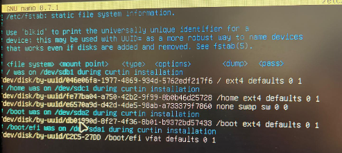<br><sub><em>Figura 26. Contenido del archivo /etc/fstab en Ubuntu Server</em></sub></p>

### 3.7 Despliegue de la máquina virtual cliente Linux Mint

El cliente se crea también como máquina virtual en Proxmox, a partir de la imagen `linuxmint-22.3-cinnamon-64bit.iso`. En la pestaña **SO** se elige la imagen y se indica que el sistema es de tipo Linux.

<p align="center">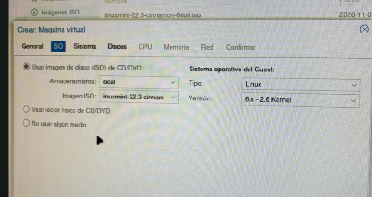<br><sub><em>Figura 27. Asistente de creación de la VM: pestaña SO</em></sub></p>

En la pestaña **Sistema** se selecciona el arranque UEFI (OVMF) y el controlador VirtIO SCSI single.

<p align="center">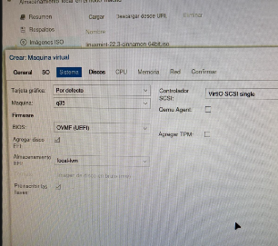<br><sub><em>Figura 28. Asistente de creación de la VM: pestaña Sistema</em></sub></p>

En la pestaña **Discos** se crea el primer disco, de 15 GiB. La máquina tiene además dos discos de 30 GiB.

<p align="center">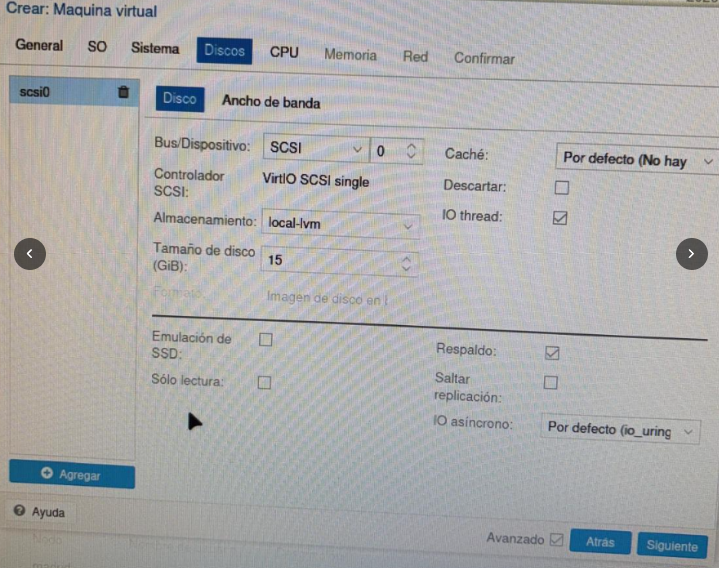<br><sub><em>Figura 29. Asistente de creación de la VM: pestaña Discos</em></sub></p>

Durante la instalación se prepara el particionado del cliente. En la captura se asigna la partición `/dev/sdc1` a `/home` y se marca para formatearla.

<p align="center">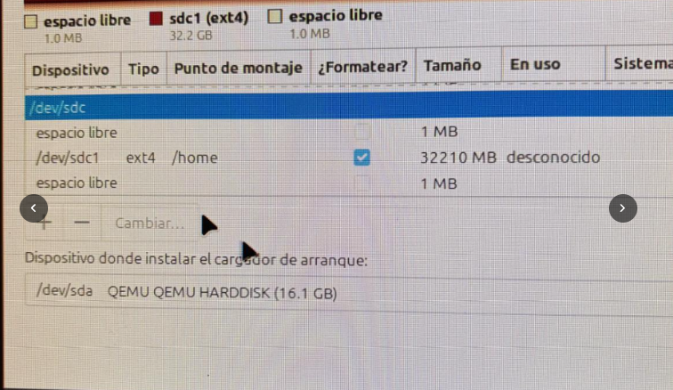<br><sub><em>Figura 30. Particionado del disco del cliente Linux Mint</em></sub></p>

Por último, se crea el usuario del equipo (`mintmadrid`) y su contraseña.

<p align="center">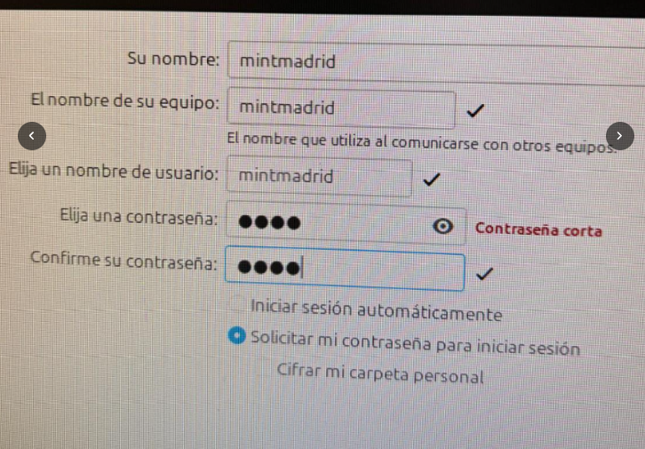<br><sub><em>Figura 31. Creación del usuario y la contraseña del cliente</em></sub></p>

### 3.8 Verificación del almacenamiento en Linux Mint

Ya instalado el cliente, se repiten las comprobaciones en la terminal: se lista el contenido de `/sys/firmware/efi` y se ejecuta `lsblk`, que muestra los discos y sus particiones.

```
$ ls -l /sys/firmware/efi
$ lsblk -o NAME,FSTYPE,SIZE,MOUNTPOINTS
```

El resultado muestra los tres discos: `sda` (15 GB) con `/boot/efi` y `/boot`, `sdb` (30 GB) con `/` y `sdc` (30 GB) con `/home`.

<p align="center">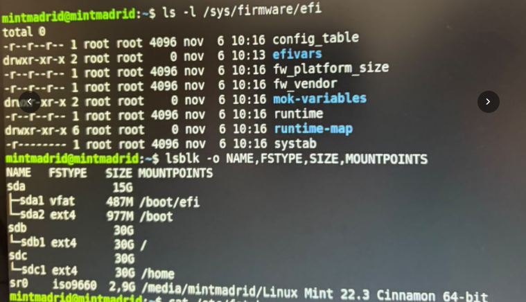<br><sub><em>Figura 32. Contenido de /sys/firmware/efi y resultado de lsblk</em></sub></p>

Finalmente, se consulta `/etc/fstab` del cliente, que lista las particiones que se montan al arrancar.

```
$ cat /etc/fstab
```

<p align="center">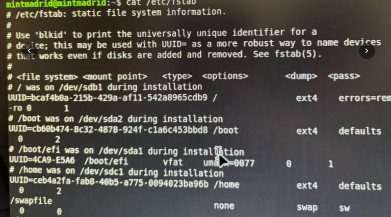<br><sub><em>Figura 33. Contenido del archivo /etc/fstab en Linux Mint</em></sub></p>

---

# Práctica 4. Despliegue de servicios con Windows Server

En esta práctica se despliega un servidor **Windows Server 2025** como máquina virtual en Proxmox. Será el nuevo servidor central de la sede de Madrid y, además del almacenamiento para datos corporativos, ofrecerá el servicio **DHCP** para que los clientes obtengan su configuración IP de forma automática.

### 4.1 Planificación de la infraestructura

Antes de crear la máquina se planifican los recursos hardware, el almacenamiento, la red y el nombre del servidor.

**Características de la máquina virtual**

| Componente | Configuración |
|:--|:--|
| Sistema operativo | Windows Server 2025 Standard (Evaluation) |
| Firmware | UEFI (`ovmf`) con chipset Q35 |
| Procesador | 1 zócalo, 2 núcleos, tipo `x86-64-v3` |
| Memoria | 8192 MiB (8 GB) |
| Discos | 4 discos virtuales sobre `local-lvm` (60 GB + 50 GB + 50 GB + 20 GB) |
| Red | Adaptador Intel E1000 conectado al puente `vmbr0` (VLAN 210) |
| Imagen de instalación | ISO de Windows Server 2025 en español |

**Esquema de discos y volúmenes**

Cada disco tiene una única función, de modo que el sistema, los datos y las copias de seguridad quedan separados:

| Disco | Tamaño | Estilo | Volumen | Etiqueta | Sistema de ficheros | Uso |
|:-:|:-:|:-:|:-:|:--|:-:|:--|
| Disco 1 | 60 GB | GPT | `C:` | *(sistema)* | NTFS | Sistema operativo (+ particiones EFI, MSR y recuperación) |
| Disco 2 | 50 GB | GPT | `D:` | Corporatiu | NTFS | Recursos compartidos corporativos |
| Disco 3 | 50 GB | GPT | `E:` | Departaments | NTFS | Datos departamentales |
| Disco 0 | 20 GB | GPT | `F:` | Backup | NTFS | Copias de seguridad |


**Esquema de red**

El servidor se integra en la VLAN 210 (`servidor_mad`) junto con el resto de equipos de la sede. Las direcciones de la .1 a la .4 se reservan para equipos con IP fija y a partir de la .5 se reparten por DHCP:

| Dispositivo | IP | Tipo de asignación |
|:--|:--|:--|
| **Proxmox** (host) | 10.2.10.1/24 | Estática |
| **Linux Mint** (cliente) | 10.2.10.2/24 | Estática |
| **Ubuntu Server** | 10.2.10.3/24 | Estática |
| **Windows Server** | 10.2.10.4/24 | Estática |
| **Clientes DHCP** | 10.2.10.5 – 10.2.10.15 | Dinámica (ámbito DHCP) |

```
                    Switch Cisco (VLAN 210 · servidor_mad · 10.2.10.0/24)
                         │                               │
                     Puerto 11                       Puerto 12
                         │                               │
          ┌──────────────┴──────────────┐        Linux Mint (cliente)
          │  Proxmox VE · 10.2.10.1     │           10.2.10.2
          │  puente vmbr0               │
          │   ├─ ubuntuSRV · 10.2.10.3  │
          │   ├─ linuxmint (VM)         │
          │   └─ Windows Server 10.2.10.11    │ ← servidor DHCP (.100 – .200)
          └─────────────────────────────┘
```

**Nombre del servidor y del dominio**

- **Servidor: `WS2025-ASIX02`.** Sigue el formato que pide la práctica (`WS2025-ASIXXX`): indica el sistema operativo (Windows Server 2025), el ciclo y el número de grupo (el 2, el mismo que se usa en el segundo octeto de todas nuestras redes 10.**2**.x.x). Así el equipo se identifica de un vistazo dentro del laboratorio.
- **Dominio: `madrid.local`.** Hace referencia a la sede del grupo y usa el sufijo `.local`, que no existe en Internet, para que el dominio interno no entre en conflicto con ningún dominio público.

### 4.2 Instalación de Windows Server 2025

Se crea la máquina virtual en el nodo `madrid` con el asistente de Proxmox. En la pestaña **CPU** se asignan 1 zócalo y 2 núcleos, con el tipo de procesador `x86-64-v3`, que expone al invitado las instrucciones modernas que requiere Windows Server 2025.

<p align="center">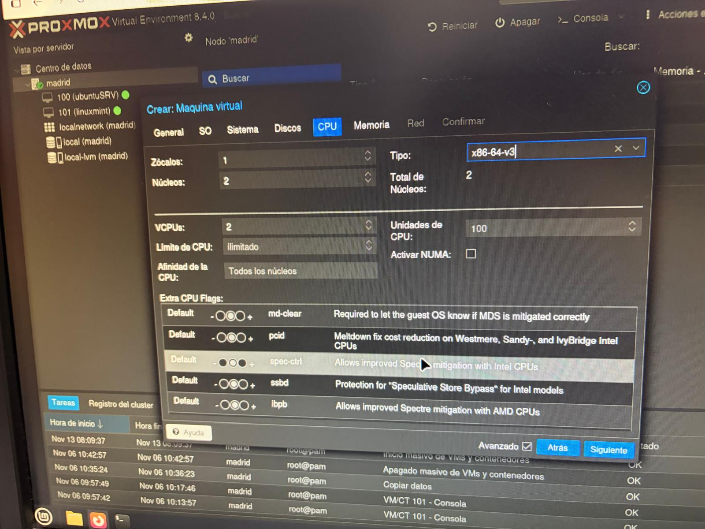<br><sub><em>Figura 34. Asistente de creación de la VM: pestaña CPU</em></sub></p>

En la pestaña **Memoria** se asignan 8192 MiB, el mínimo exigido por la práctica. El mínimo de memoria también se fija en 8192 MiB, por lo que el *ballooning* no reducirá nunca la RAM de la máquina por debajo de ese valor.

<p align="center">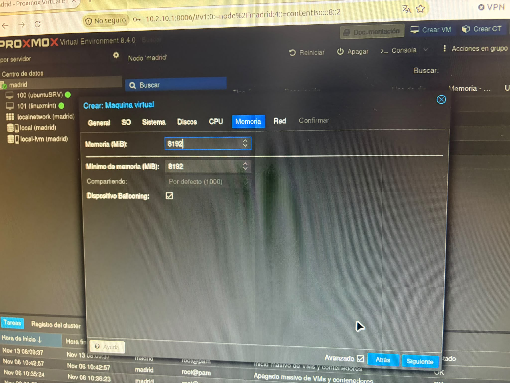<br><sub><em>Figura 35. Asistente de creación de la VM: pestaña Memoria</em></sub></p>

Al arrancar el instalador, en la pantalla de selección de ubicación aparecen los cuatro discos. Se instala el sistema en el **Disco 1** (60 GB). Como la máquina arranca en modo UEFI, el instalador crea automáticamente la tabla GPT con la partición de sistema EFI (200 MB), la partición reservada MSR (16 MB) y la partición principal (59,8 GB). Los otros tres discos se dejan sin asignar para configurarlos después.

<p align="center">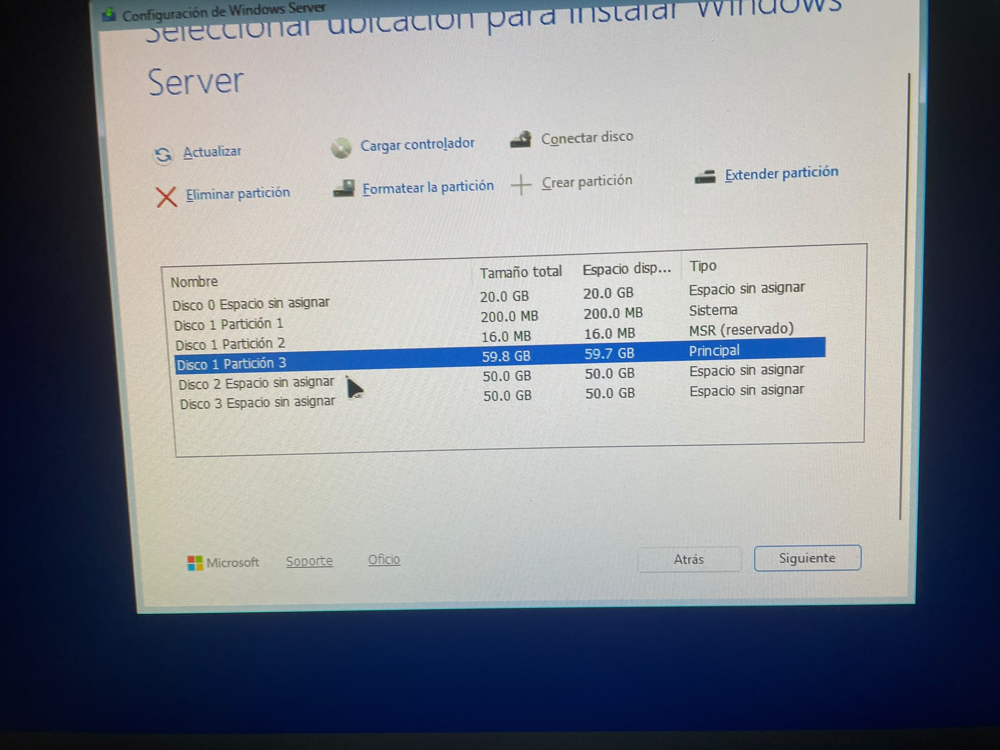<br><sub><em>Figura 36. Particiones creadas durante la instalación</em></sub></p>

Al terminar la instalación se establece la contraseña del usuario `Administrador` y aparece la pantalla de inicio de sesión.

<p align="center">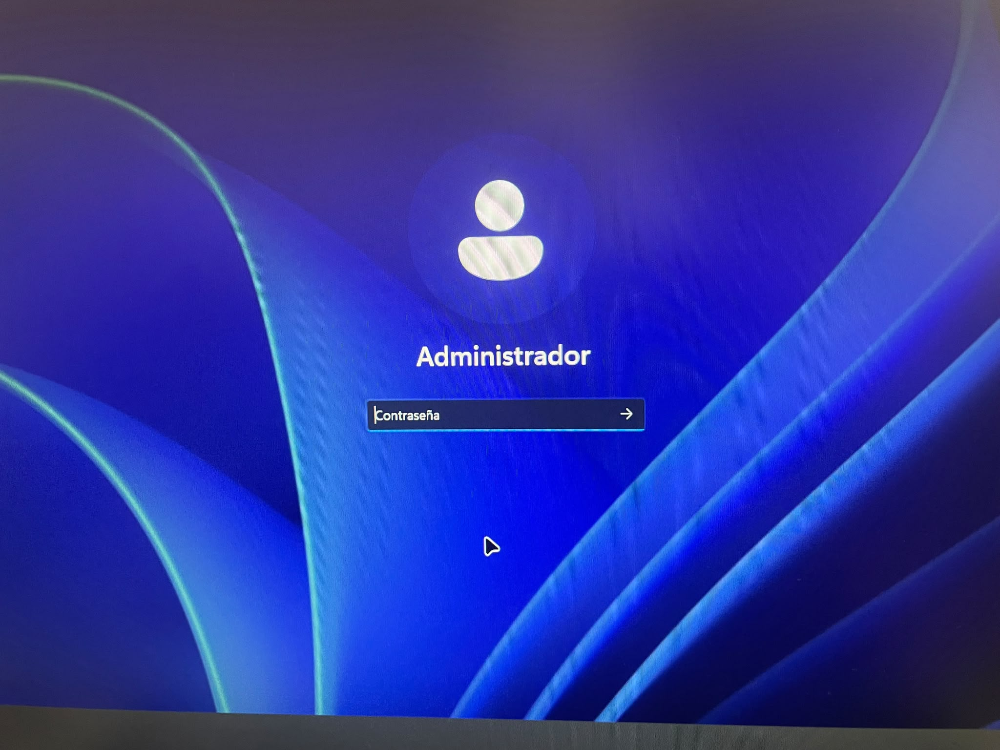<br><sub><em>Figura 37. Pantalla de inicio de sesión de Windows Server</em></sub></p>

Una vez dentro, en **Configuración → Sistema → Información** se comprueba que la edición es **Windows Server 2025 Standard Evaluation** (versión 24H2, compilación 26100.32230), con 8 GB de RAM, procesador virtual QEMU y sistema de 64 bits. El equipo conserva todavía el nombre generado automáticamente (`WIN-E283CN95EQG`), que se cambiará por `WS2025-ASIX02` desde el botón **Cambiar el nombre de este equipo**.

<p align="center">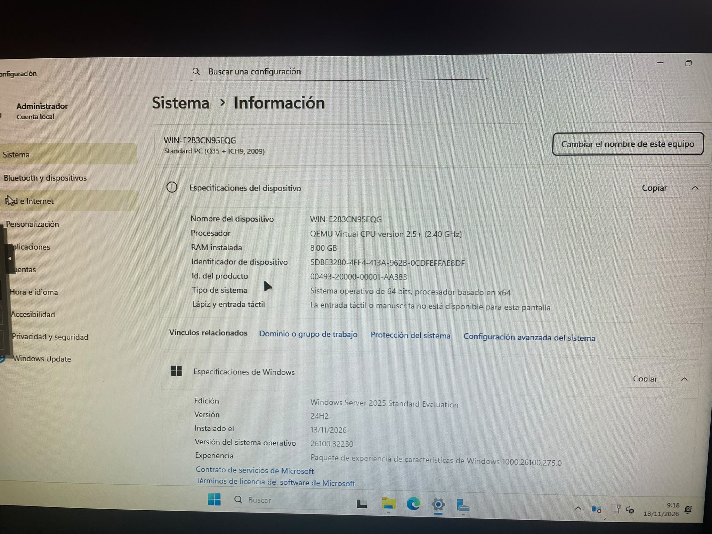<br><sub><em>Figura 38. Información del sistema</em></sub></p>

### 4.3 Configuración del almacenamiento

Se abre la herramienta **Administración de discos** con el comando `diskmgmt.msc`. Al detectar los discos 0, 2 y 3 sin inicializar, Windows pide inicializarlos; se seleccionan los tres y se elige el estilo **GPT**.

```
C:\> diskmgmt.msc
```

<p align="center">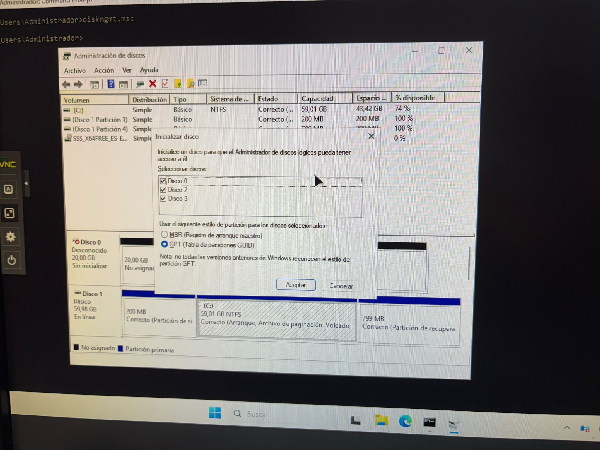<br><sub><em>Figura 39. Inicialización de los discos secundarios en GPT</em></sub></p>

Después, sobre el espacio no asignado de cada disco se crea un **volumen simple** con el asistente (botón derecho → *Nuevo volumen simple*), formateado en NTFS, con su letra de unidad y su etiqueta. Al terminar, los tres volúmenes aparecen en la lista en estado *Correcto*: `D:` Corporatiu y `E:` Departaments (49,98 GB cada uno) y `F:` Backup (19,98 GB).

<p align="center">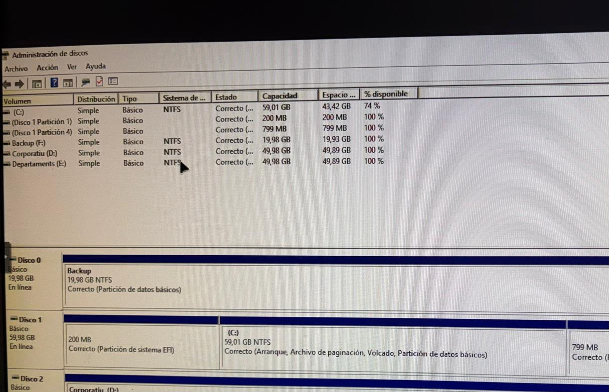<br><sub><em>Figura 40. Volúmenes creados en Administración de discos</em></sub></p>

**Criterios empleados**

- **Un disco por función.** El sistema, los datos y las copias van en discos distintos: si hay que reinstalar Windows, los datos de `D:` y `E:` no se ven afectados, y las copias de `F:` no comparten disco con los datos que protegen.
- **GPT.** Es el estilo que corresponde a un sistema UEFI y se usa en todos los discos para mantener el mismo criterio que en el disco del sistema.
- **Volúmenes simples.** Cada volumen ocupa un disco entero, así que no es necesario usar volúmenes distribuidos ni seccionados.
- **NTFS.** Permite asignar permisos por usuario y grupo (ACL), imprescindible para unas carpetas que se compartirán en red.
- **Letras y etiquetas.** Se respetan las letras de la configuración propuesta (`D:` corporativo, `E:` departamental, `F:` copias) y cada volumen se etiqueta con su uso para identificarlo fácilmente.

### 4.4 Configuración TCP/IP del servidor

En las propiedades de **Protocolo de Internet versión 4 (TCP/IPv4)** del adaptador se elige *Usar la siguiente dirección IP* y se asigna la dirección estática **10.2.10.4**, la máscara de subred y, como servidor DNS preferido, **8.8.8.8**. Un servidor necesita una IP fija para que los clientes lo encuentren siempre en la misma dirección, y más aún si va a ofrecer el servicio DHCP.

<p align="center">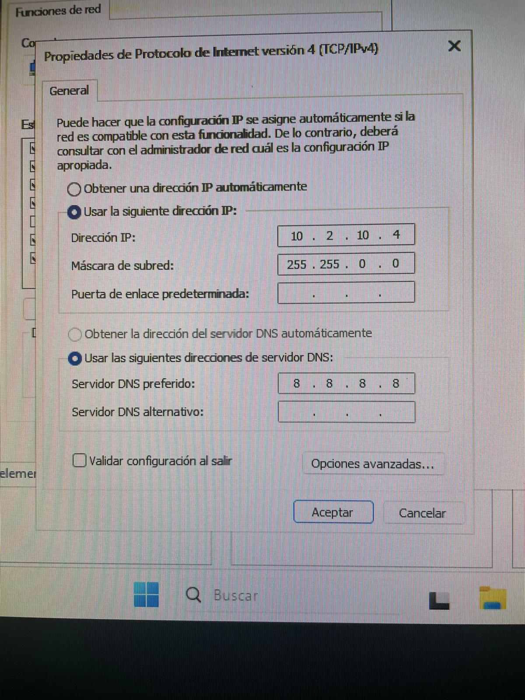<br><sub><em>Figura 41. Configuración IP estática del adaptador</em></sub></p>

Para comprobar la conectividad se hace `ping` al host **Proxmox** (10.2.10.1) y al cliente **Linux Mint** (10.2.10.2). Los dos responden sin pérdida de paquetes y con un TTL de 64, valor típico de los sistemas Linux, lo que confirma que el servidor se comunica con el resto de equipos de la VLAN 210.

```
C:\> ping 10.2.10.1
C:\> ping 10.2.10.2
```

<p align="center">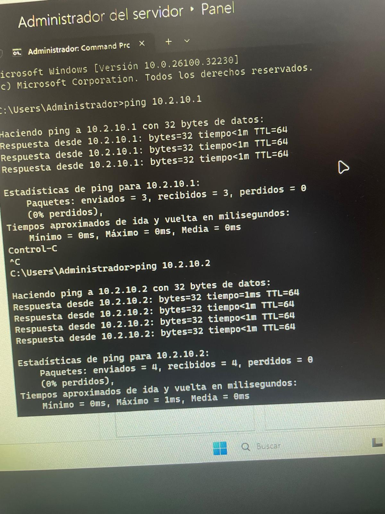<br><sub><em>Figura 42. Ping al servidor Proxmox y al cliente Linux Mint</em></sub></p>

Por último, se ejecuta `ipconfig /all`. La salida confirma la configuración aplicada: adaptador Intel PRO/1000 MT, DHCP deshabilitado, dirección IPv4 10.2.10.4 y servidor DNS 8.8.8.8.

```
C:\> ipconfig /all
```

<p align="center">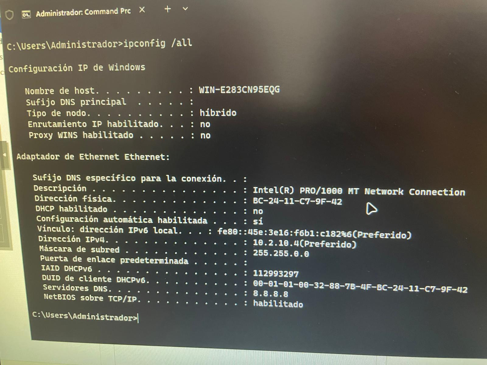<br><sub><em>Figura 43. Resultado de ipconfig /all en Windows Server</em></sub></p>

### 4.5 Instalación y configuración del servicio DHCP

Desde el **Administrador del servidor** se abre el *Asistente para agregar roles y características* y se marca el rol **Servidor DHCP**. El asistente propone añadir también las herramientas de administración del servidor DHCP, necesarias para gestionarlo, y se aceptan con **Agregar características**.

<p align="center">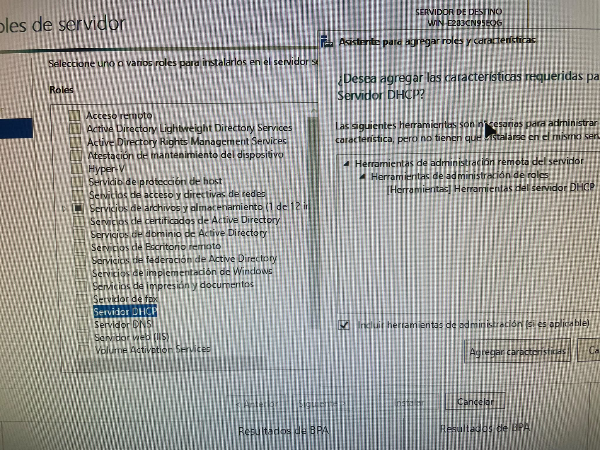<br><sub><em>Figura 44. Instalación del rol Servidor DHCP</em></sub></p>

Una vez instalado el rol, en la consola DHCP se crea un nuevo ámbito IPv4 con el *Asistente para ámbito nuevo*. Primero se le da un nombre y una descripción que indica el rango que reparte.

<p align="center">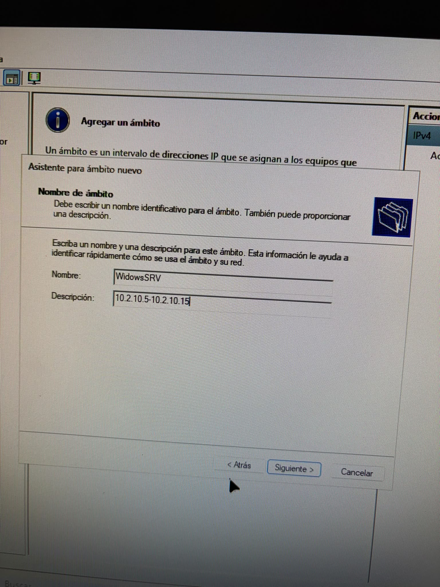<br><sub><em>Figura 45. Nombre y descripción del ámbito</em></sub></p>

A continuación se define el rango de direcciones, de la **10.2.10.5** a la **10.2.10.15**, con la máscara **255.255.255.0** (/24). El rango empieza en la .5 para no solapar con las IP estáticas de Proxmox, Linux Mint, Ubuntu Server y Windows Server (.1 a .4).

<p align="center">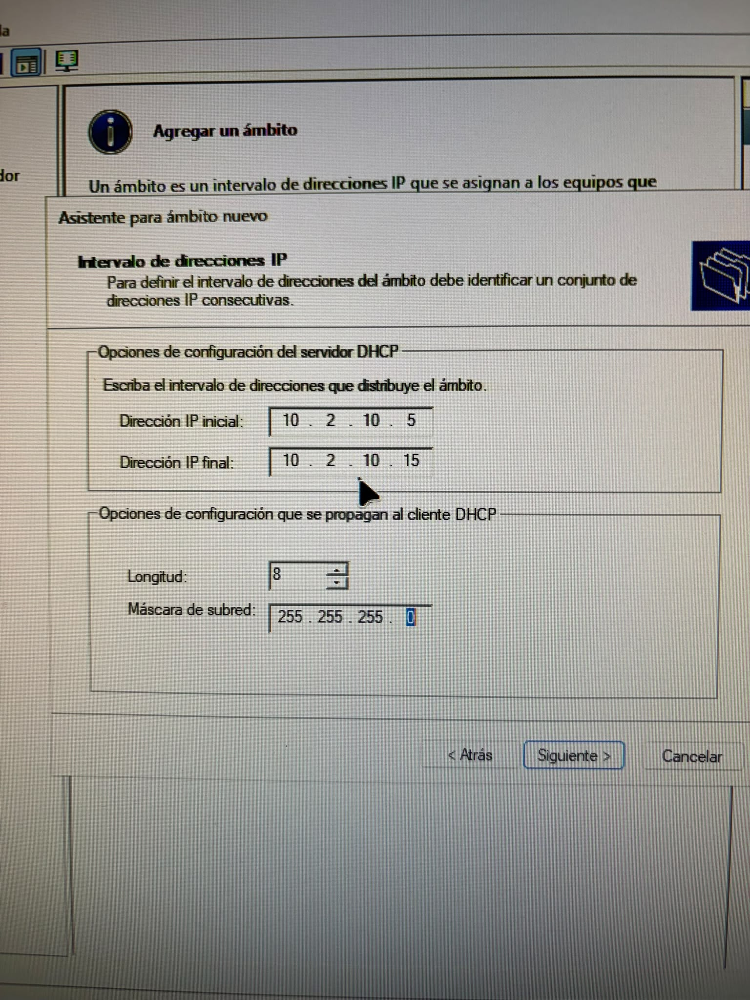<br><sub><em>Figura 46. Rango de direcciones del ámbito</em></sub></p>

En un **cliente virtual** configurado para obtener la IP automáticamente se ejecuta `ipconfig /all`. La salida muestra una dirección dentro del rango 10.2.10.5 – 10.2.10.15, el servidor DHCP que la ha concedido (10.2.10.4) y el resto de opciones recibidas.

```
C:\> ipconfig /all
```

<p align="center"><br><sub><em>Figura 47. ipconfig /all en el cliente virtual</em></sub></p>

Por último, al **cliente físico** se le asigna siempre la misma dirección mediante una **reserva** en el servidor DHCP, asociada a la dirección MAC de su tarjeta de red. El resultado de `ipconfig /all` muestra que el equipo recibe por DHCP la dirección reservada.

```
C:\> ipconfig /all
```

<p align="center"><br><sub><em>Figura 48. ipconfig /all en el cliente físico</em></sub></p>

---

<div align="center">

**Projecte Intermodular** · Enric Soler i Godes · 2º ASIX · Grupo Madrid

</div>
