<div align="center">

# PROJECTE INTERMODULAR

### Fase 1

**Enric Soler i Godes** · 2º ASIX
**Grupo Madrid**

</div>

---

## Índice

- [Práctica 2. Instalación de Proxmox en el servidor y estudio de IPs](#práctica-2-instalación-de-proxmox-en-el-servidor-y-estudio-de-ips)
  - [2.1 Instalación del hipervisor Proxmox VE](#21-instalación-del-hipervisor-proxmox-ve)
  - [2.2 Despliegue del cliente Linux](#22-despliegue-del-cliente-linux)
  - [2.3 Acceso y configuración del switch Cisco](#23-acceso-y-configuración-del-switch-cisco)
  - [2.4 Creación y nombrado de las VLAN](#24-creación-y-nombrado-de-las-vlan)
  - [2.5 Asignación de interfaces a las VLAN](#25-asignación-de-interfaces-a-las-vlan)
  - [2.6 Verificación de las VLAN](#26-verificación-de-las-vlan)
- [Práctica 3. Despliegue de equipos](#práctica-3-despliegue-de-equipos)
  - [3.1 Inventario de dispositivos](#31-inventario-de-dispositivos)
  - [3.2 Segmentación en VLAN](#32-segmentación-en-vlan)
  - [3.3 Asignación de puertos del switch Cisco](#33-asignación-de-puertos-del-switch-cisco)
  - [3.4 Verificación de conectividad](#34-verificación-de-conectividad)

---


# Práctica 2. Instalación de Proxmox en el servidor y estudio de IPs

### 2.1 Instalación del hipervisor Proxmox VE

Se descarga la imagen ISO oficial de Proxmox VE, que será el hipervisor instalado directamente sobre el hardware (*bare metal*) del servidor físico.

<p align="center">
  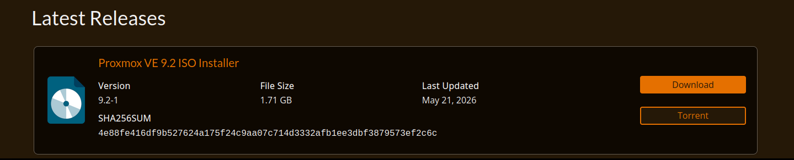<br>
  <sub><em>Figura 1. Descarga de la ISO de Proxmox</em></sub>
</p>

Para generar el medio de instalación se utiliza **balenaEtcher**, herramienta que escribe la imagen ISO en un dispositivo USB y lo deja configurado como unidad de arranque.

<p align="center">
  <br>
  <sub><em>Figura 2. Descarga de balenaEtcher</em></sub>
</p>

Se selecciona la ISO de origen y la unidad USB de destino, y se lanza el proceso de escritura (*flasheo*) del medio.

<p align="center">
  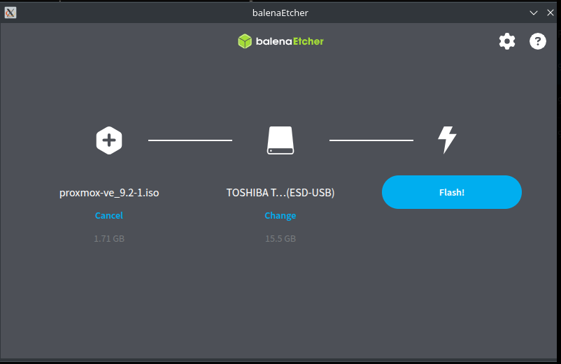<br>
  <sub><em>Figura 3. Preparación para flashear la ISO</em></sub>
</p>

A continuación se arranca el servidor físico desde el USB y se ejecuta el asistente de instalación de Proxmox VE.

<p align="center">
  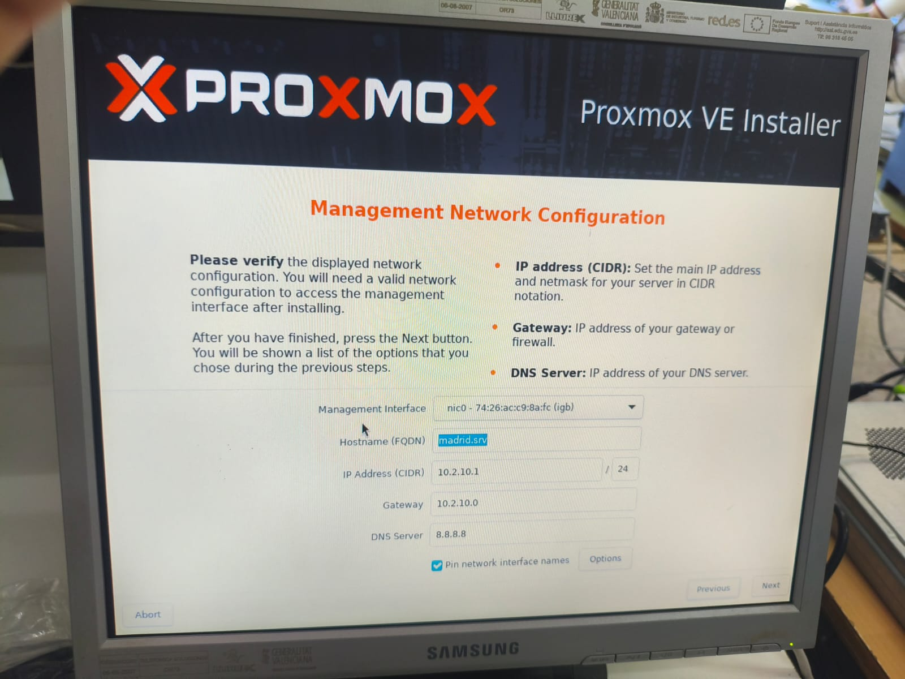<br>
  <sub><em>Figura 4. Servidor encendido</em></sub>
</p>

<p align="center">
  <br>
  <sub><em>Figura 5. Instalación de Proxmox</em></sub>
</p>

Durante la instalación se configura la red de gestión del servidor (dirección IP, máscara de subred, puerta de enlace y DNS). Una vez finalizada, se comprueba que los parámetros se han aplicado correctamente.

<p align="center">
  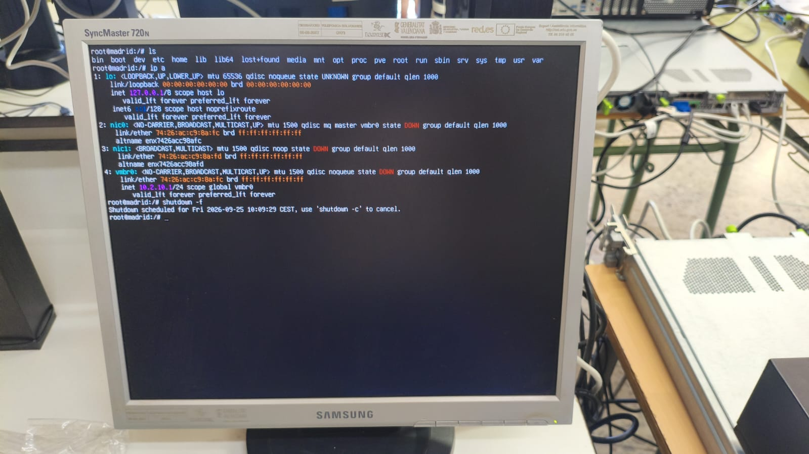<br>
  <sub><em>Figura 6. Configuración de las IPs del servidor</em></sub>
</p>

### 2.2 Despliegue del cliente Linux

Se despliega el cliente Linux Mint en la estación de trabajo.

> ⚠️ **Nota:** la captura pertenece a pruebas previas con Ubuntu Client, descartado por incompatibilidades técnicas. No se documentó gráficamente la instalación final de Linux Mint.

<p align="center">
  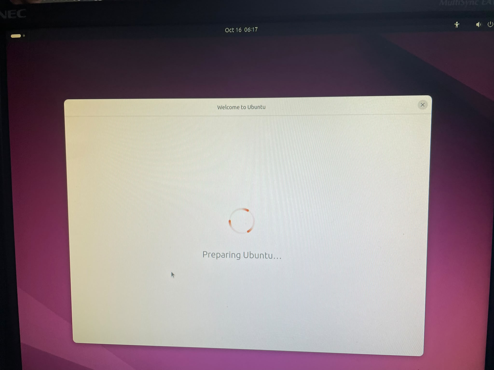<br>
  <sub><em>Figura 7. Instalación de Ubuntu (pruebas previas)</em></sub>
</p>

### 2.3 Acceso y configuración del switch Cisco

Se instala y configura **PuTTY** como cliente de terminal para acceder al switch Cisco y habilitar el acceso remoto por **Telnet**.

<p align="center">
  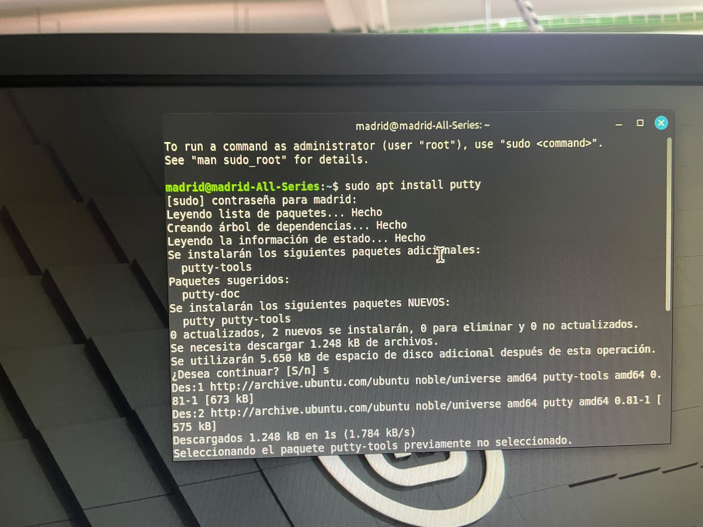<br>
  <sub><em>Figura 8. Instalación de PuTTY</em></sub>
</p>

<p align="center">
  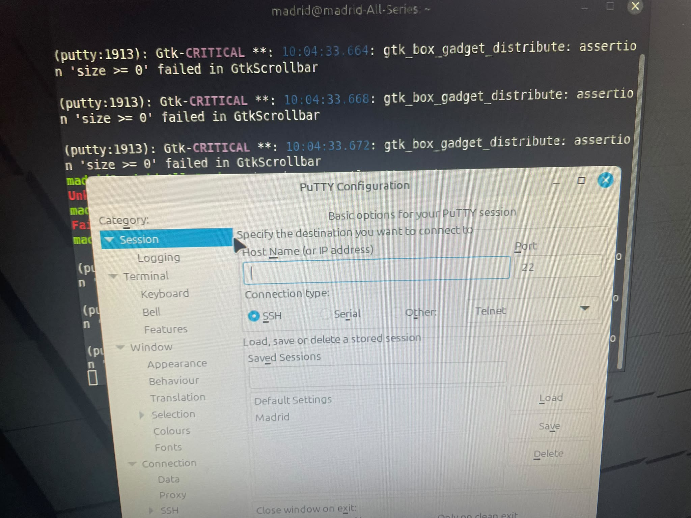<br>
  <sub><em>Figura 9. Configuración de PuTTY</em></sub>
</p>

Se realiza la configuración inicial del switch (acceso de gestión y parámetros básicos).

<p align="center">
  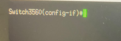<br>
  <sub><em>Figura 10. Switch (detalle)</em></sub>
</p>

<p align="center">
  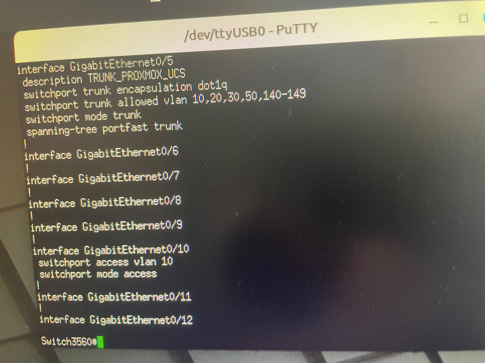<br>
  <sub><em>Figura 11. Configuración del switch</em></sub>
</p>

Se verifica que la configuración se ha guardado correctamente y que es posible conectarse al switch por Telnet directamente, sin necesidad de PuTTY.

<p align="center">
  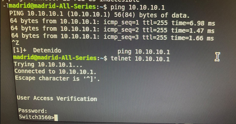<br>
  <sub><em>Figura 12. Comprobación de la conexión por Telnet</em></sub>
</p>

### 2.4 Creación y nombrado de las VLAN

Se crean las VLAN en el switch y se les asigna el nombre correspondiente según su función.

```
Switch(config)# vlan <id>
Switch(config-vlan)# name <nombre>
```

<p align="center">
  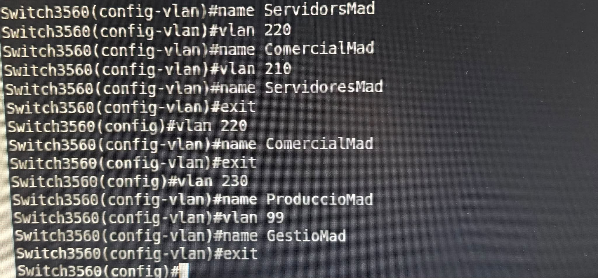<br>
  <sub><em>Figura 13. Nombres de las VLAN</em></sub>
</p>

### 2.5 Asignación de interfaces a las VLAN

Se accede a la interfaz `GigabitEthernet 0/12` del switch Cisco. Una vez dentro, se configura la interfaz en **modo acceso** (`switchport mode access`) y se le asigna la **VLAN 210** (`switchport access vlan 210`), de modo que el puerto pase a transportar únicamente tráfico sin etiquetar de dicha VLAN.

```
Switch(config)# interface GigabitEthernet 0/12
Switch(config-if)# switchport mode access
Switch(config-if)# switchport access vlan 210
```

<p align="center">
  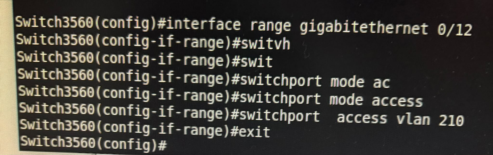<br>
  <sub><em>Figura 14. Configuración de la interfaz Gi0/12</em></sub>
</p>

El mismo procedimiento se repite para el resto de interfaces y VLAN.

<p align="center">
  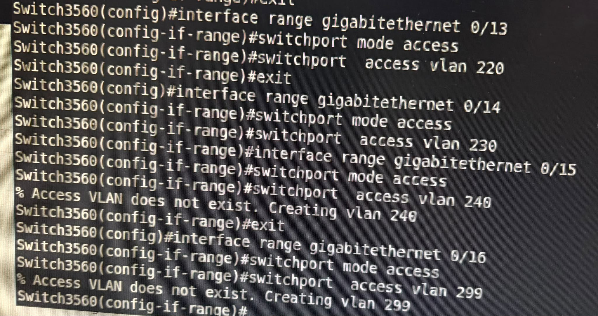<br>
  <sub><em>Figura 15. Configuración del resto de VLAN</em></sub>
</p>

### 2.6 Verificación de las VLAN

Se ejecuta el comando `show vlan brief` para validar la creación de las VLAN y la asignación de puertos. En la comprobación se detectan algunos errores de configuración (nombres o puertos asignados incorrectamente).

<p align="center">
  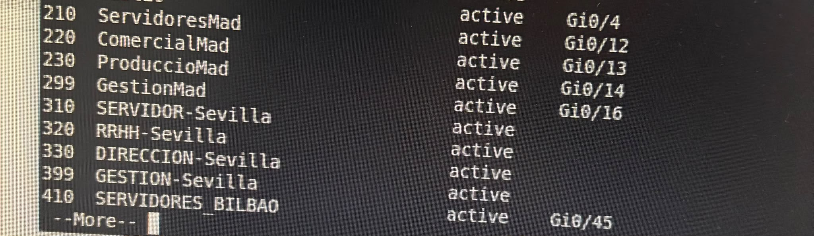<br>
  <sub><em>Figura 16. Resultado de show vlan brief</em></sub>
</p>

---

# Práctica 3. Despliegue de equipos

Se corrigen los errores detectados y se vuelve a ejecutar `show vlan brief` para confirmar que el estado de las VLAN y la asignación de puertos son los esperados.

<p align="center">
  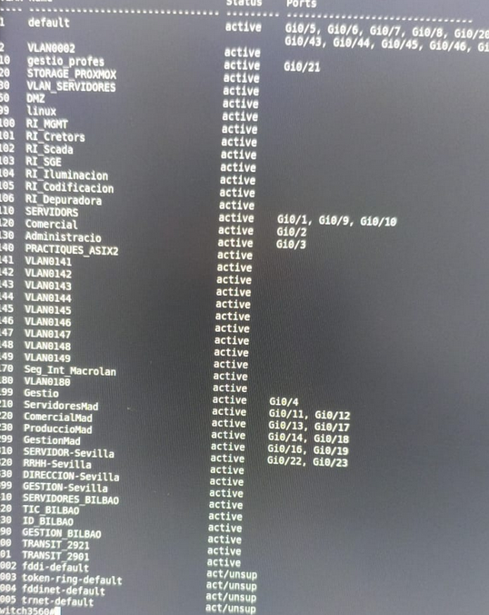<br>
  <sub><em>Figura 17. show vlan brief tras corregir</em></sub>
</p>

### 3.1 Inventario de dispositivos

Estos son los dispositivos de los que disponemos y sus características:

| Dispositivo | Tipo | IP | VLAN | Puerto | Estado |
|:--|:--|:--|:-:|:--|:--|
| **Proxmox** | Servidor físico | 10.2.10.1/24 | 210 | 11 | Conectado |
| **Linux Mint** | Cliente físico | 10.2.10.2/24 | 210 | 12 | Conectado |
| **Ubuntu Server** | Servidor físico | 10.2.10.3/24 | 210 | Sin asignar | No conectado aún |
| **Switch Cisco** | Gestión | 10.2.99.1/24 | 299 | Puerto de gestión | Activo |

### 3.2 Segmentación en VLAN

Estas son las VLAN que hemos asignado. Cada una dispone de su propio direccionamiento IP /24 y de una pareja de interfaces del switch:

| VLAN | Nombre | Red | Interfaces del switch |
|:-:|:--|:--|:-:|
| **210** | servidor_mad | 10.2.10.0/24 | 11, 12 |
| **220** | comercial_mad | 10.2.20.0/24 | 13, 17 |
| **230** | produccion_mad | 10.2.30.0/24 | 14, 18 |
| **299** | gestion_mad | 10.2.99.0/24 | 16, 19 |

### 3.3 Asignación de puertos del switch Cisco

Esta es la distribución final de los puertos 11 a 20 del switch Cisco, con la VLAN a la que pertenece cada uno y el dispositivo conectado en la actualidad:

| Puerto | VLAN | Nombre VLAN | Dispositivo conectado |
|:-:|:-:|:--|:--|
| 11 | 210 | servidor_mad | Servidor Proxmox |
| 12 | 210 | servidor_mad | Cliente Linux Mint |
| 13 | 220 | comercial_mad | *Libre* |
| 14 | 230 | produccion_mad | *Libre* |
| 15 | Sin asignar | - | *Libre* |
| 16 | 299 | gestion_mad | *Libre* |
| 17 | 220 | comercial_mad | *Libre* |
| 18 | 230 | produccion_mad | *Libre* |
| 19 | 299 | gestion_mad | *Libre* |
| 20 | Sin asignar | - | *Libre* |

### 3.4 Verificación de conectividad

Verificamos que la configuración de red está correctamente configurada y realizamos un `ping` al servidor para comprobar la conectividad entre cliente y servidor dentro de la VLAN 210.

<p align="center">
  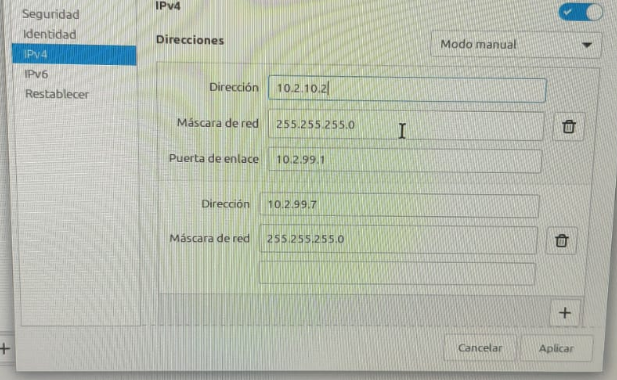<br>
  <sub><em>Figura 18. Configuración de la red</em></sub>
</p>

<p align="center">
  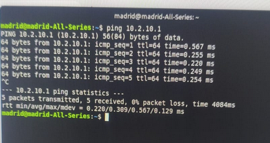<br>
  <sub><em>Figura 19. Ping entre cliente y servidor</em></sub>
</p>

---

<div align="center">

**Projecte Intermodular** · Enric Soler i Godes · 2º ASIX · Grupo Madrid

</div>
