# PROJECTE INTERMODULAR

**ENRIC SOLER I GODES — 2 ASIX**

## GRUPO: MADRID

---

Descargamos la ISO correspondiente del “Proxmox”.

Descargamos el programa que sirve para cargar la ISO en el USB.

Ahora preparamos todo para “flashear” la ISO en el USB.

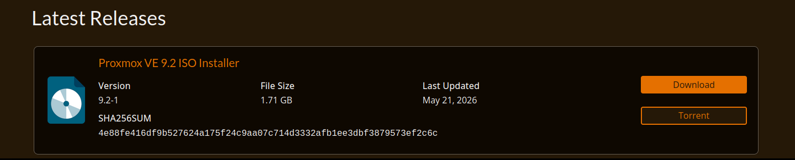

Encendemos el servidor y le instalamos el “Proxmox” a éste.

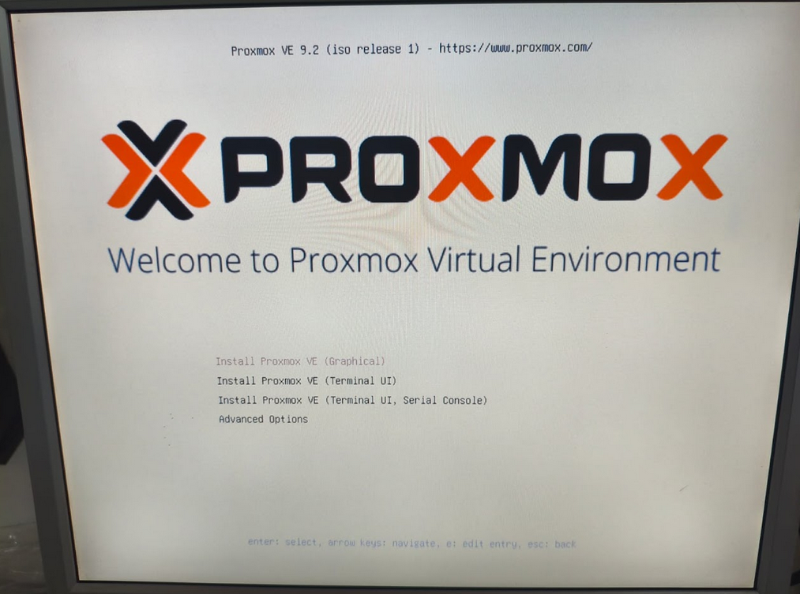

Configuramos las Ips del servidor, y comprobamos si se han aplicado los cambios.

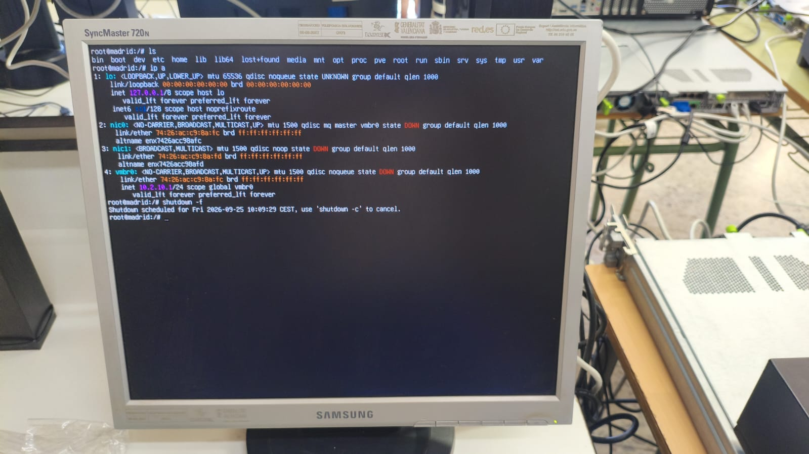

Instalamos el cliente de Linux Mint al ordenador (la captura es de Ubuntu Client porque probamos con este SO pero no funcionó y no hicimos fotos de la instalación de linux mint.)

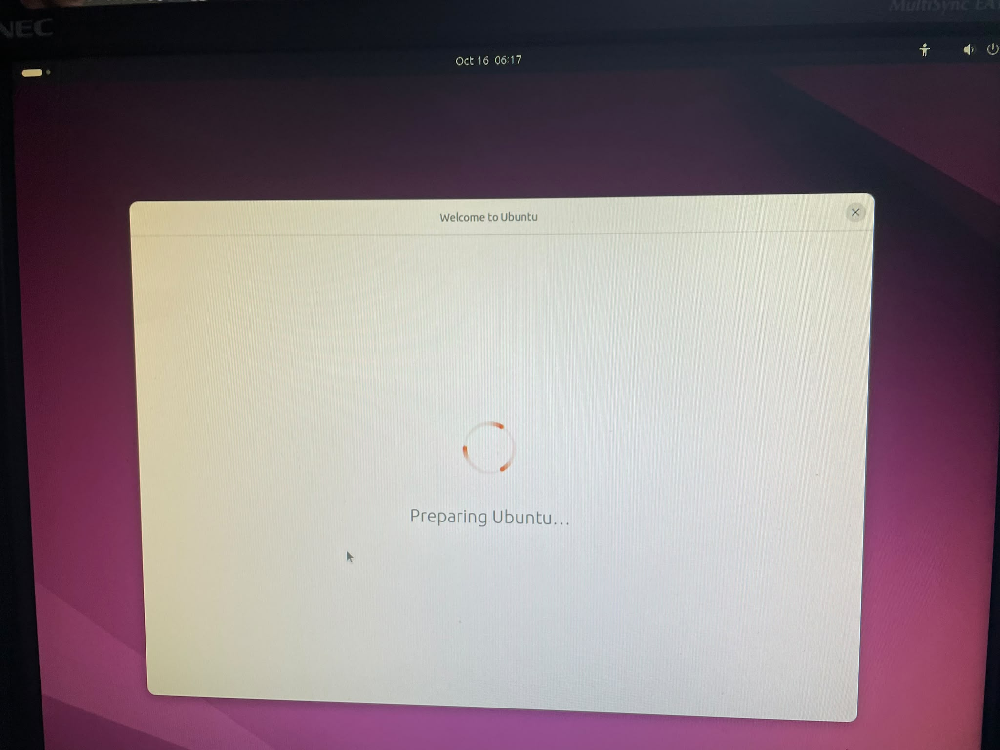

Instalamos y configuramos el “Putty”, para abrir los puertos del switch y conectarlo a telnet.

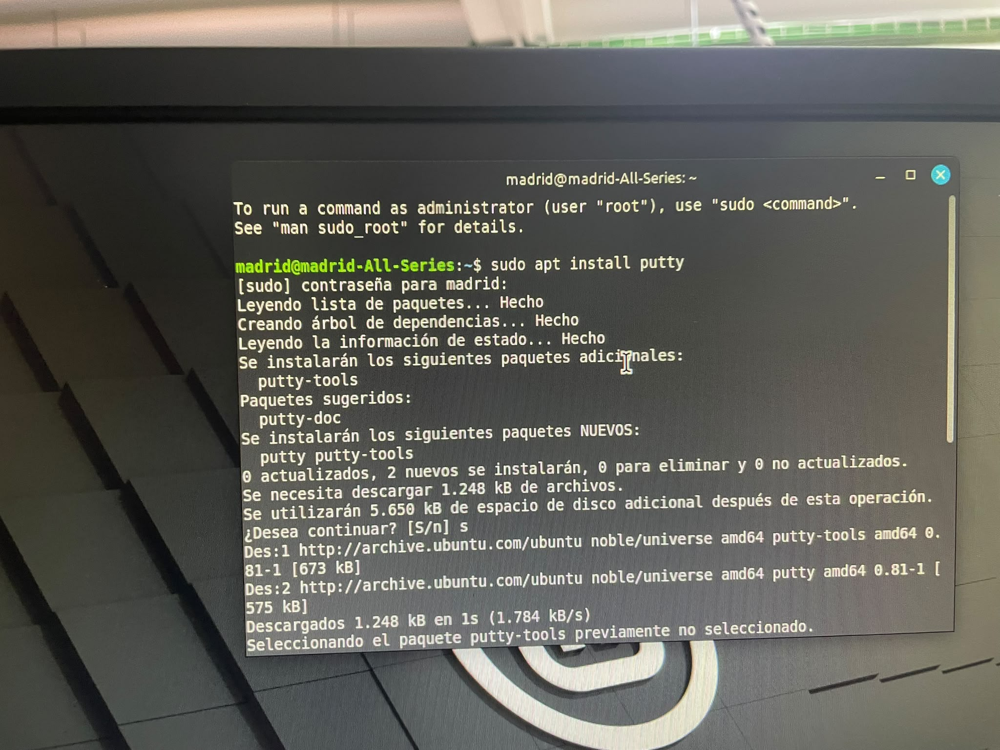

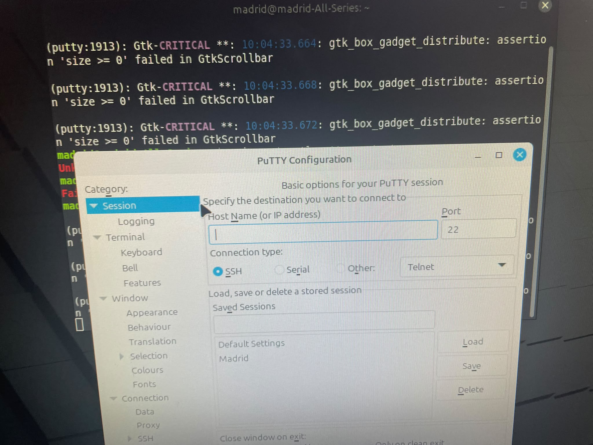

Configuramos el switch.

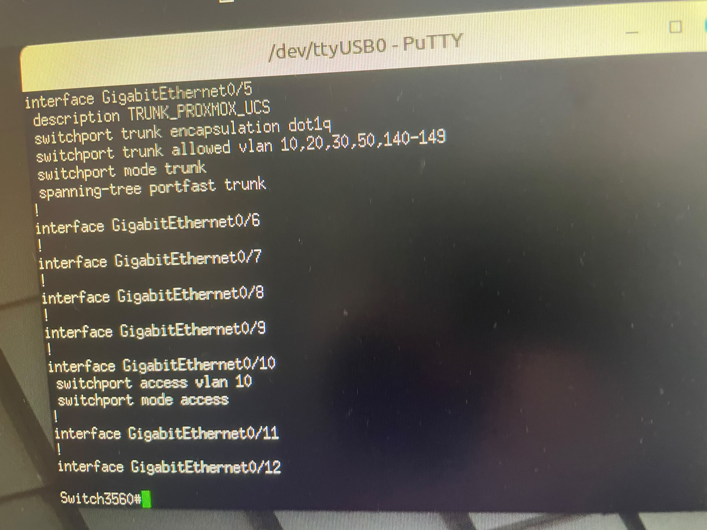

Comprobamos si los cambios se han guardado correctamente y vemos si nos podemos conectar al switch sin necesidad del “Putty”.

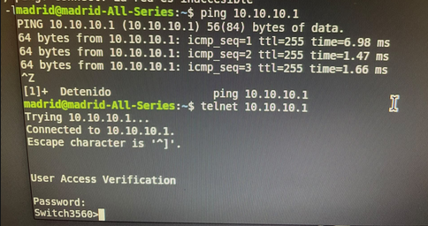

Empezamos el día asignándole los nombres correspondientes a las VLAN.

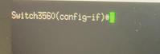

En la captura se accede a la interfaz GigabitEthernet 0/12 de un switch Cisco.
Una vez dentro, se configura esa interfaz en modo acceso (`switchport mode access`) y se le asigna la VLAN 210 (`switchport access vlan 210`).

Repetimos el proceso con todas las VLAN

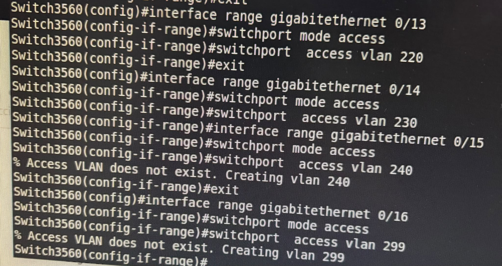

Aquí ponemos el comando “`show vlan brief`” para verificar que hemos creado correctamente las VLAN. En la comprobación nos percatamos de que hemos hecho algunos erorres.

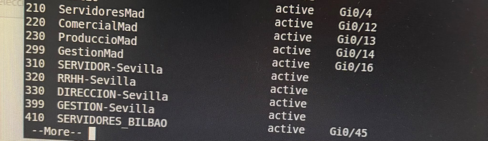

Corregimos los errores y volvemos a ejecutar el comando “`show vlan brief`” para ver si ya hemos corregido los errores.

