 

##  Sobre el proyecto

Proyecto intermodular del grupo Madrid (2º ASIX): diseño, despliegue y documentación de la infraestructura de red y servidores de la sede de Madrid.

<table>
<tr>
<td width="33%" valign="top" align="center">
  
<b>Red:</b> switch Cisco segmentado en cuatro VLAN (210, 220, 230 y 299), con acceso de gestión por Telnet.
</td>
<td width="33%" valign="top" align="center">
  
<b>Virtualización:</b> hipervisor Proxmox VE sobre un servidor físico, con máquinas virtuales Ubuntu Server y Linux Mint.
</td>
<td width="33%" valign="top" align="center">
  
<b>Servicios:</b> Windows Server 2025 con almacenamiento en cuatro discos y servicio DHCP para la VLAN 210.
</td>
</tr>
</table>

##  Documentación

| Documento | Qué contiene |
|:--|:--|
| 📘 **[Fase 1](Documentacio/FASE_1/FASE_1.md)** | Prácticas 2, 3 y 4: esquema de red, Proxmox VE, VLAN, máquinas virtuales, Windows Server y DHCP |
| 🗓️ **[Bitácora semanal](Bitacora/Semanal/Bitacora_Semanal.md)** | Objetivos, logros e incidencias del grupo, semana a semana |
| 👤 **[Bitácoras personales](Bitacora/Personal/)** | Registro individual de cada integrante |
| 📁 **[Carpeta de Google Drive](https://drive.google.com/drive/folders/1KXfeQd_wecn5S_aBjsynbgepLF8Dm7n8?usp=drive_link)** | Carpeta compartida con los documentos de trabajo |

##  Equipo

<table>
<tr>
<td align="center" valign="top" width="20%"> <b>Daniel Llorca</b> Cabeza del proyecto <a href="Bitacora/Personal/Dani_Llorca.md">Bitácora de Daniel</a></td>
<td align="center" valign="top" width="20%"> <b>Ismael Cerveró</b> Secretario <a href="Bitacora/Personal/Ismael_Cervero.md">Bitácora de Ismael</a></td>
<td align="center" valign="top" width="20%"> <b>Amin Boutighmass</b> Secretario suplente <a href="Bitacora/Personal/Amin_.md">Bitácora de Amin</a></td>
<td align="center" valign="top" width="20%"> <b>Marc Sancho</b> Responsable técnico <a href="Bitacora/Personal/Marc_Sancho.md">Bitácora de Marc</a></td>
<td align="center" valign="top" width="20%"> <b>Javier Ferri</b> Responsable técnico suplente <a href="Bitacora/Personal/Javi_Ferri.md">Bitácora de Javier</a></td>
</tr>
</table>

##  Estado

- [x] **Práctica 2.** Proxmox VE, switch Cisco y VLAN
- [x] **Práctica 3.** Ubuntu Server y Linux Mint sobre Proxmox
- [x] **Práctica 4.** Windows Server 2025, servicio DHCP y DHCP Snooping

##  Herramientas

| Uso | Herramienta |
|:--|:--|
| Comunicación |  |
| Documentación |   |
| Repositorios |   |
| Diagramas y mapas |  |
| Gestión del proyecto |  |

 

Projecte Intermodular · Grupo Madrid

